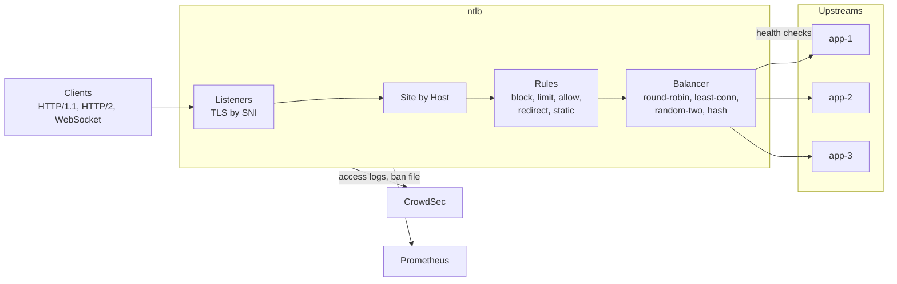
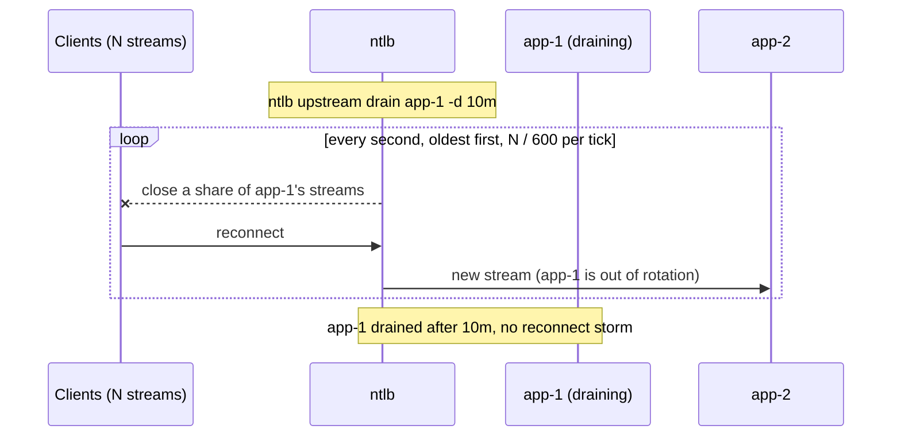

# ntlb

A small HTTP load balancer built for [ntfy](https://ntfy.sh): balancing per site (round robin,
least connections, random two, or sticky hashing of the client IP that every load balancer
instance agrees on), active health checks, long-lived streams (JSON/SSE/raw, WebSocket, HTTP/2),
streaming bodies, gzip, and **paced** draining, so that taking a node or a load balancer out of
service never makes tens of thousands of clients reconnect at the same second.

It is built for ntfy, but nothing in it is ntfy-only, and its defaults are those of a generic load
balancer (nginx's where it has one): which requests are long-lived streams (`streams`; default:
none), the balancing (`balance`; default: round-robin), the health check path (default `/`) and
the client key (`client-key`) are configurable, so it fits any HTTP backend, also with long-lived
streams (SSE, long polling, WebSockets). The ntfy site in
[packaging/sites.d/ntfy.yml](packaging/sites.d/ntfy.yml) sets ntfy's. One instance can serve several **sites** (virtual hosts), each with its own
listen addresses, hosts, certificate, upstreams, health checks, rules and access logs, in the main
file or in included files (`include: [sites.d/*.yml]`, merged like `sshd_config.d`).

It replaces the nginx + lbagent pair on the ntfy.sh load balancers (ansible: `playbooks/lb.yml`,
`roles/ntlb` in `ntfy/ansible`). What it took over from that setup is listed under
[nginx parity](#nginx-parity). Every setting, the expression language and
recipes: [docs/configuration.md](docs/configuration.md); diagrams of the components and flows:
[docs/architecture.md](docs/architecture.md); internals and lab results: [docs/design.md](docs/design.md).

## Overview



A subscription takes the stream path: one raw upstream connection, the client connection
hijacked (HTTP/1.1), one goroutine and no buffer while it waits. Drains close streams at a pace:



## Features

- **Balancing per site** (`balance`): `round-robin` (default, like nginx), `least-conn` (fewest
  open requests on this load balancer), `random-two` (the less busy of two random upstreams, like
  nginx's `random two least_conn`, which stays balanced with several load balancers), or `hash`:
  sticky, consistent routing by rendezvous (highest random weight) hashing of the client IP (IPv4,
  or the IPv6 /64, like ntfy's `visitor-prefix-bits-ipv6`) over the upstream *names*. With `hash`,
  any number of load balancers with the same upstream names send a client to the same node, which
  keeps ntfy's in-memory rate limits in one place; removing a node moves only its clients, adding
  one only takes its share. (nginx ignores `consistent` for upstreams that resolve by DNS, as on
  ntfy.sh, so there every node change reshuffled most clients.) The ntfy site uses `hash`.
- **Active health checks** (`GET /` every 5s by default, any 2xx or 3xx is healthy, on every
  address of every upstream; the ntfy site probes `/v1/ready`) with hysteresis: out after 3 failed probes in a row, back after 2 good ones. An
  upstream is up if any of its addresses is; a dead address is skipped. A new upstream, or one
  whose addresses changed, is probed before it gets traffic. If no upstream is healthy, it fails
  open and uses all of them.
- **Retries like nginx's `proxy_next_upstream error timeout http_503`**: a connection failure goes
  to the next upstream for any request (it never reached a node); other errors only for idempotent
  methods; a 503 (a draining ntfy node) only if no body byte was sent. A body that was partly sent
  is never resent. A node's other addresses are tried before the next node.
- **Long-lived streams**: flushes every write, an upstream idle timeout (`upstream-read-timeout`,
  60s like nginx's `proxy_read_timeout`; 3m in the ntfy config) that also bounds clients that stop reading, a 60s bound on a stalled upload
  (nginx's `client_body_timeout`), WebSocket
  upgrades, HTTP/2 on the TLS listener. Subscriptions (`streams.match`) take a
  lean path (raw upstream connection, no buffer held while idle, hijacked HTTP/1.1 connections):
  ~11 KiB per stream over HTTP/1.1, ~32 KiB with TLS, ~37 KiB over HTTP/2.
- **Streaming bodies** in both directions (`proxy_buffering off`, `proxy_request_buffering off`,
  `client_max_body_size 0`).
- **TCP keepalives** towards clients and upstreams, configurable (idle, interval, count).
- **Several addresses per upstream** (e.g. one node's ports), each good for ~63k connections from
  one source IP; new streams go to the address with the fewest.
- **Sites**: each site lists its listen addresses (`listen-http`, `listen-https`; sites can share
  them). On each address, a request goes to the site whose `hosts` match its `Host` header (names
  and `*.name` wildcards), else to the one site there without hosts, else gets a 404. HTTPS picks
  the certificate among the address's sites by SNI. Included files are merged into the main file
  (lists appended, anything else set once), so a site can be a drop-in file. A reload applies
  added, changed and removed sites, also on new or removed listen addresses. Upstream names are
  per site.
- **Reload without cutting streams** (`SIGHUP`, `systemctl reload`, `ntlb reload`): sites and
  their listen addresses (new ones are bound, removed ones stop accepting while their streams run
  on), upstreams, health checks, timeouts, drain durations, streams, the client key, rules, bans,
  the TLS certificates and the log files. Streams to upstreams that stay are untouched.
  `listen-admin`, `listen-metrics`, `listen-profiler` and `client-keepalive` need a restart, and so does an address
  that switches between HTTP and HTTPS; a reload says so. A broken config (or certificate, log
  path or listen address) is rejected as a whole.
- **Rules, changed live** (global ones for every site, then the site's own): block, rate limit,
  allow, redirect or serve from disk the requests a
  boolean expression matches (method, path, query, host, scheme, client IP and networks, headers;
  `&&`, `||`, `!`, regexes): abusive topics or user agents, a per-IP request limit like nginx's
  `limit_req` and exemptions from it, the HTTP -> HTTPS redirect, a static website. Expressions
  are in [expr](https://expr-lang.org), the language of CrowdSec's filters, and are checked when
  the config loads. A reload swaps them without cutting open streams.
- **Bans**: rules add strikes per client (blocks, exceeded limits, and response rules that look at
  the outcome, e.g. repeated 400s); a client over a threshold within a window gets one line in a
  ban file, for CrowdSec to turn into a firewall ban, like ntfy's own ban feed. Usually global; a
  site can have its own settings and file.
- **Access logs split by outcome**: several files, each with a response expression (e.g. `status
  < 400` to `access.log`, the rest to `access_error.log`), in nginx's `combined` format plus
  key=value fields, so existing parsers keep working. Global, or per site (a site's own replace
  the global ones for it).
- **Paced draining**: an upstream removed from the config, an upstream drained by command, and the
  load balancer itself (by command or on `SIGTERM`) close their streams oldest first, evenly spread
  over a duration. A draining load balancer turns away new *subscriptions* (so clients back off or
  go to another load balancer instead of coming back to be drained again) but keeps serving
  publishes.
- **gzip** of responses, like nginx's `gzip` with `gzip_proxied any`: listed media types, level 6,
  at least 1100 bytes, streamed responses compressed as they go; subscriptions are never compressed.
- **`/v1/health` and `/v1/ready`** like ntfy's, plus a status API, Prometheus metrics (client
  connections, requests by site/upstream/code/kind, durations, streams by protocol, retries,
  drains, rule matches, bans, Go and process metrics) on the admin listener and, for Prometheus on
  a private network, on a separate `/metrics`-only listener, pprof on the admin listener and on a
  separate profiler-only listener (`listen-profiler`), and a CLI on top.

## Status and results

Prototype, written and lab-tested on 2026-11-04. Not deployed anywhere. All tests pass with the
race detector (`make race`); `make lint` is clean apart from errcheck.

### Soak test

Three hours, 20,000 streams with the production protocol mix against three real ntfy nodes and
two load balancers, through drains, reloads, a load balancer restart and a `kill -9` of a node:
0 messages lost in steady state, delivery p99 ~2ms, no LB panics, memory flat. Details in
[docs/design.md](docs/design.md#soak-test-2026-11-05).

### Compared to nginx

Same load against both (40,000 streams, 150 publishes/s, 430 polls/s, production protocol mix,
nginx with the production LB config): both delivered every message with no errors. Memory is
about even (1.99 vs 2.04 GiB; nginx has ~630 MiB fixed, ntlb more per stream). ntlb uses
~2x the CPU (0.75 vs 0.35 cores) and has a higher p99 (6-8 ms vs ~4 ms), with p50 equal at
~1 ms. Details in [docs/design.md](docs/design.md#nginx-comparison-2026-11-05).

### Lab results

Two Proxmox VMs on box13: three independent (unclustered) ntfy nodes, and two ntlb instances
with the same upstream names in a different order. A load generator held 2000 JSON subscriptions
from 200 source IPs and published to each topic. Since the nodes are not clustered, a message
only arrives if the subscribe and the publish hit the same node, which makes every routing mistake
visible.

| Test | Result |
|---|---|
| Subscribe via LB a, publish via LB b | 1405/1405 delivered; both LBs route every IP the same; load spread 640/611/750 |
| Drain one upstream over 30s | 610 streams closed at a steady 20-21/s; clients moved to the other nodes |
| Reload that removes an upstream (1m drain) | 12-13 closes/s for 60s, then the upstream is forgotten; other streams untouched |
| Kill an ntfy node | 0 client errors (connection refused is retried on the next node); out after ~5s, back ~4s after restart |
| Restart an LB (30s drain) | `/v1/ready` 503 at once; flat 66-67 closes/s; new subscriptions 503, publishes served; 2000 streams back within 5s |
| WebSocket and HTTP/2 streams | delivered; both closed by drains |
| 5000 streams each over HTTP/1.1, HTTP/1.1+TLS, HTTP/2 | all messages delivered; memory below |

Found and fixed along the way:

- **Reconnect snowball.** A draining LB that still accepted subscriptions got its own drained
  clients back, and the pacing went from 67 to 1100 closes/s. Draining LBs now refuse new
  subscriptions with 503 (publishes are still served).
- **Early closes.** Rounding closes up per tick closed everything well before the deadline. Pacing
  now carries fractional credit.
- **Missing log lines.** Aborted streams were not access-logged; the log write is now deferred.

### Memory per stream

5000 idle JSON streams, access log on, measured as RSS per stream:

| Client protocol | Generic proxy path | Stream path (current) | Goroutines |
|---|---|---|---|
| HTTP/1.1 | 68 KiB | **11 KiB** | 4 -> 1 |
| HTTP/1.1 + TLS | 91 KiB | **32 KiB** | 4 -> 1 |
| HTTP/2 + TLS | 70 KiB | **37 KiB** | 3.3 -> 1.3 |

Plain HTTP/1.1 is now in nginx's range. The remaining TLS cost is crypto/tls, which keeps ~6 KiB
per connection and cannot release its buffers while idle (OpenSSL can). The remaining HTTP/2 cost
is the stdlib h2 server: a 4 KiB writer and a handler goroutine per stream, and h2 connections
cannot be hijacked.

### Production traffic (lb1, 2026-11-04)

- ~70% of subscription stream time is HTTP/2. For the Android app (OkHttp) it is ~90%.
- ~3,300 client connections on :443 and ~110 on :80.
- So today's footprint would be tens of MB. At 100k streams with the same mix, expect ~3.5 GB
  (it was ~7 GB before the stream path).

### Behavior differences from nginx

- HTTP/1.1 subscription responses end with `Connection: close` and a close-delimited body instead
  of chunked encoding. That is valid HTTP, and streams end with their connection anyway.
- A dead HTTP/1.1 subscriber is noticed on the next write (at most ntfy's 45s keepalive) or by
  TCP keepalive, because the LB no longer reads from these connections.
- Requests Go rejects before the handler (malformed request lines, oversized headers, a request cut
  off mid-headers, slowloris) are logged with the request `"-"` and status 400, where nginx logs
  the garbage line and 400/414. They count for response rules like `status == 400 &&
  upstream_status == 0`. A header over 64 KiB gets 431 (nginx: 400/414 over 8 KiB per line).
- The access log escapes like nginx (`\xHH` for quotes, backslashes, non-printable bytes, and
  spaces in the unquoted fields), caps each field at 4 KiB, and redacts `auth=` query values (the
  web app's credentials), which nginx logged verbatim.
- HTTP/2 `:path` and `:authority` are checked like Go's HTTP/1 parser does it (400 otherwise).
- An upgraded connection (WebSocket) ends when the upstream ends it or after
  `upstream-read-timeout` without traffic either way; drains close it without a close frame (the
  ntfy clients do not reconnect after one).
- TLS 1.2 offers only AEAD suites (Mozilla intermediate, as in the nginx config). `action: static`
  serves only clean paths (no `.`, `..` or empty segments, no dotfiles) and no symlink out of root.

### Open items

- The ansible side (role, CrowdSec scenario for the ban file, monitoring): in the ntfy ansible
  repo, see [nginx parity](#nginx-parity).
- Optional: turn off HTTP/2 on the LB. The app would move to HTTP/1.1 over TLS (~32 KiB instead of
  ~37 KiB), at the cost of one TCP+TLS connection per subscription. Not worth it at today's size.
- Rollout plan (one LB at a time behind DNS, or side by side on another port first).

## Quick start

```bash
make                                   # fmt-check, vet, tests, build/ntlb
sudo install -m 755 build/ntlb /usr/bin/ntlb
sudo install -D -m 644 packaging/config.yml /etc/ntlb/config.yml   # then edit them
sudo install -D -m 644 packaging/sites.d/ntfy.yml /etc/ntlb/sites.d/ntfy.yml
sudo install -m 644 packaging/ntlb.service /etc/systemd/system/
ntlb check-config
sudo systemctl enable --now ntlb
ntlb status
```

## Configuration

ntlb reads `/etc/ntlb/config.yml` and the files it includes; `ntlb check-config` validates them,
and a reload applies them without cutting a stream. **[docs/configuration.md](docs/configuration.md)
documents everything**:

- [Config files](docs/configuration.md#config-files)
- [Global settings](docs/configuration.md#global-settings)
- [Sites](docs/configuration.md#sites)
- [Upstreams and balancing](docs/configuration.md#upstreams-and-balancing)
- [Health checks, and what happens when one goes bad](docs/configuration.md#health-checks-and-what-happens-when-one-goes-bad)
- [Streams](docs/configuration.md#streams)
- [Access logs](docs/configuration.md#access-logs)
- [Rules](docs/configuration.md#rules)
- [Bans](docs/configuration.md#bans)
- [Compression](docs/configuration.md#compression)
- [The expression language](docs/configuration.md#the-expression-language)
- [Recipes](docs/configuration.md#recipes)
- [Running as a regular user, and certificates](docs/configuration.md#running-as-a-regular-user-and-certificates)

The ntfy.sh setup, shortened ([packaging/config.yml](packaging/config.yml) and
[packaging/sites.d/ntfy.yml](packaging/sites.d/ntfy.yml) are the complete, commented version):

```yaml
# /etc/ntlb/config.yml
listen-admin: "127.0.0.1:2590"        # admin API: no auth, keep it local
listen-metrics: "10.108.0.2:25031"    # only /metrics, for Prometheus
listen-profiler: "127.0.0.1:6060"     # only /debug/pprof/
upstream-read-timeout: 3m             # default 60s; ntfy sends a keepalive every 45s
access-logs:                          # for sites without their own, and requests no site serves
  - {file: /var/log/nginx/access.log, match: status < 400}
  - {file: /var/log/nginx/access_error.log}
bans: {file: /var/log/ntlb/ban.log, window: 10m, threshold: 100}
gzip: {types: [text/html, text/plain, application/json]}   # like nginx's gzip; a site may replace it
rules:                                # global: checked first, for every site
  - name: abuse
    match: ipIn(ip, "203.0.113.0/24", "198.51.100.7") || header("User-Agent") matches "(?i)spy"
    action: block                     # 403
    strike: 20                        # towards a ban (more than threshold within window)
  - name: bad-requests
    on: response                      # sees status, upstream_status and rule; only strikes
    match: status == 400 && upstream_status == 0
    strike: 1
include: [sites.d/*.yml]              # merged into this file: lists appended, the rest set once
```

```yaml
# /etc/ntlb/sites.d/ntfy.yml
sites:
  - name: ntfy
    listen-http: ":80"                # one address or a list; other sites can share them
    listen-https: ":443"
    hosts: [ntfy.sh, "*.ntfy.sh"]     # leave out: every host no other site on these addresses serves
    cert-file: /etc/ntlb/certs/fullchain.pem   # copied by the certbot hook
    key-file: /etc/ntlb/certs/privkey.pem
    # access-logs: [{file: /var/log/ntlb/ntfy.log}]   # instead of the global ones
    balance: hash                     # default round-robin; also least-conn, random-two
    health-check: {path: /v1/ready}   # default /
    streams:                          # default none; ntfy's subscriptions, minus polls
      match: method == "GET" && path matches "^/[-_A-Za-z0-9]{1,64}(,[-_A-Za-z0-9]{1,64})*/(json|sse|raw|ws)$" && !flag("x-poll", "poll", "po")
    upstreams:
      - name: app1                    # the NAME is what clients hash to: keep names equal on all LBs
        addresses: ["10.108.0.11:25010-25017"]
      - name: app3
        addresses: ["10.108.0.13:25010-25017"]
    rules:                            # after the global rules; logged as "ntfy/<name>"
      - name: https-redirect
        match: scheme == "http" && method == "GET" && path == "/"
        action: redirect
        location: '"https://" + host + uri'
      - name: spam-topic
        match: path matches "(^/|,)spam-topic(,|/|$)"   # also inside "/a,b/json"
        action: block
        strike: 101                   # over the threshold: banned on the first request
      - name: limit-exempt
        match: ipIn(ip, "116.203.112.46", "176.126.240.0/24")
        action: allow                 # stops checking: these skip the limit below
      - name: limit                   # no match: every request
        action: limit                 # per client IP (IPv6 /64), like limit_req nodelay
        rate: 45/m
        burst: 1000
        strike: 1                     # per limited request
```

Rules and streams match with expressions, for example:

```
ipIn(ip, "10.0.0.0/8") || header("User-Agent") matches "(?i)curl"   # a request rule
status == 404 && path endsWith ".php"                               # a response rule
"https://" + host + uri                                             # a redirect location
```

## CLI

Flags go anywhere on the command line. The CLI finds the admin API from `--admin-url`, else from
`listen-admin` in `--config` (default `/etc/ntlb/config.yml`).

```
ntlb serve                              run (SIGHUP reloads, SIGTERM drains then exits)
ntlb check-config [-c FILE]             validate a config file
ntlb status [--json]                    load balancer + upstream state, streams, counters
ntlb reload                             re-read the config file
ntlb drain [-d 10m] / undrain           drain the load balancer itself
ntlb upstream drain NAME [-d 10m]       take a node out of rotation, close its streams over 10m
                                        (SITE/NAME if several sites have an upstream NAME)
ntlb upstream undrain NAME              put it back
```

```
$ ntlb status
Load balancer: ready, 2000 stream(s)

SITE  UPSTREAM  STATE     STREAMS  REQUESTS  FAILURES  ADDRESSES                            NOTE
ntfy  app1      healthy   724      1136      0         192.168.1.48:2186,192.168.1.48:3186
ntfy  app2      draining  359      789       0         192.168.1.48:2286                    drained in 18s (02:16:41)
ntfy  app3      healthy   864      1353      0         192.168.1.48:2386
```

Without `-d`, drains use `drain-duration` from the config (default 5m). A drain started by command
survives reloads until `undrain`.

## Admin API

On `listen-admin` only (the public listeners proxy everything, including ntfy's own `/v1/health`).

| Method + path | |
|---|---|
| `GET /v1/health` | `{"healthy":true}`; 200 if at least one upstream in rotation is healthy, else 503 |
| `GET /v1/ready` | `{"ready":true,"draining":false}`; 200 if healthy and not draining, else 503 |
| `GET /v1/status` | full status (JSON), what `ntlb status` shows |
| `POST /v1/reload` | re-read the config; 400 with `{"error":...}` if it is invalid (nothing changes); `restart_required` lists changed settings that need a restart |
| `POST /v1/drain`, `DELETE /v1/drain` | drain / undrain the load balancer; optional body `{"duration":"10m"}` |
| `POST /v1/upstreams/{name}/drain`, `DELETE ...` | drain / undrain one upstream (`site%2Fname` if several sites have one of that name: 400 otherwise); same body |
| `GET /metrics` | Prometheus, see [docs/design.md](docs/design.md#metrics-servermetricsgo) |
| `GET /debug/pprof/` | Go profiles |

## Operating it

- **Take a node out**: `ntlb upstream drain app3 -d 10m` on every load balancer (or remove it
  from the config and reload). Its clients move to their next node in hash order, about
  `streams / 600` per second.
- **Take a load balancer out**: `ntlb drain -d 10m` (or `systemctl stop`, which uses
  `shutdown-drain-duration`). `/v1/ready` fails right away; streams close evenly over the duration;
  new subscriptions get 503 + `Connection: close`; publishes are served until the end.
- **Certificate renewal**: a certbot deploy hook that makes the new files readable for ntlb and
  runs `systemctl reload ntlb`, see
  [Running as a regular user](docs/configuration.md#running-as-a-regular-user-and-certificates). Unlike an nginx
  reload, this never cuts a stream.
- **Log rotation** (access logs, ban file): `postrotate systemctl reload ntlb`.
- **Kernel**: Go listens with a backlog of `net.core.somaxconn`, so set that to 4096 or more
  (nginx used `backlog=4096`), and widen `net.ipv4.ip_local_port_range` for upstream connections.
- **systemd**: `TimeoutStopSec` must exceed `shutdown-drain-duration` (the unit uses 5m).

## nginx parity

Taken over from the ntfy.sh nginx config: `hash $binary_remote_addr` (now consistent), the
lbagent health checks and hysteresis, `proxy_next_upstream error timeout http_503`, 5s connect
timeout, 3m read timeout, `proxy_buffering off`, `proxy_request_buffering off`,
`client_max_body_size 0`, `X-Forwarded-For` appending (`$proxy_add_x_forwarded_for`) and `Host`
passthrough, WebSocket upgrades, HTTP/2, `keepalive_timeout 65`, multiple ports per node, access
logs in the `combined_ssl` format split by outcome, `gzip` (level 6, `gzip_min_length 1100`,
`gzip_proxied any`; subscriptions are not compressed, where nginx would compress a `/raw` stream),
`worker_shutdown_timeout`-style draining (now paced), and, as rules, the abuse maps, `limit_req`
with its exemptions, the HTTP -> HTTPS redirect, the static website and the `/docs` redirects.

**Not** taken over (yet), so nginx-only today:

- the translation of today's nginx config into rules, and the switch of the CrowdSec scenarios
  to the ban file: in the ntfy ansible repo
- `lingering_time 3s` (Go reads at most 256 KiB of an unread body, then closes)
- the nginx stub_status exporter (replaced by `/metrics`)

## Development

```bash
make           # fmt-check, vet, test, build
make race      # tests with the race detector
make lint      # golangci-lint
```

Layout: `config/` (YAML config), `balancer/` (hashing, health, sessions, drains), `server/`
(listeners, proxy, admin API, access log), `client/` (admin API client), `cmd/` (CLI).
