# ntlb architecture

How ntlb is put together, in diagrams: where it runs, its components, what a request goes
through, and the flows that matter for long-lived streams (subscriptions, drains, reloads,
health, bans). The diagrams are [Mermaid](https://mermaid.js.org), which GitHub renders. The
details behind each part (invariants, numbers, lab results) are in [design.md](design.md).

## Deployment

On ntfy.sh, ntlb runs on each load balancer in front of the app nodes. Clients connect over
HTTP/1.1, HTTP/2 or WebSocket; ntlb terminates TLS, applies the rules, serves the website, and
proxies to the app nodes' private listeners. Its logs feed CrowdSec, its metrics Prometheus.

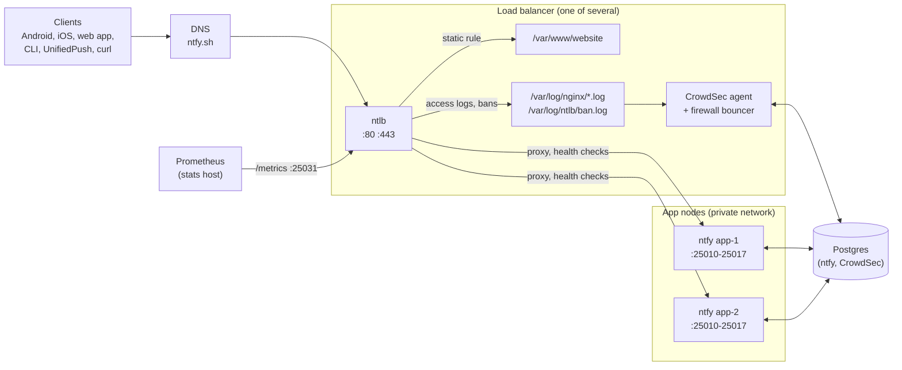

Every load balancer runs the same config, and with `balance: hash` they agree on which app node
a client goes to: the hash is over the upstream names, not over anything local to one instance.

## Components

The packages and how they depend on each other. `server` owns the listeners and the request
path; `balancer` decides where requests go and owns health and drains; `rules` decides what
happens to a request before it is proxied; `config` and `match` are shared.

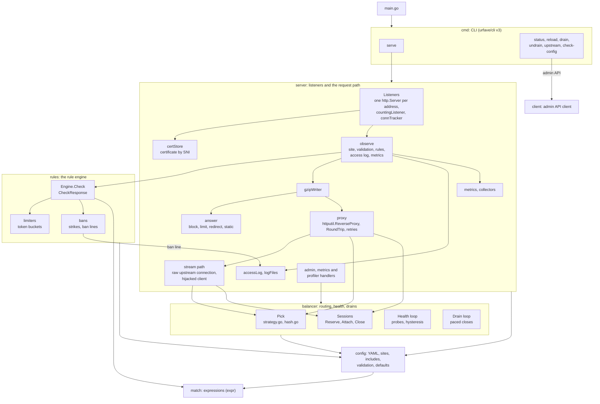

## The request path

What one request goes through, from the listener to the upstream and back. Everything the
outcome feeds (access log, response rules, metrics) runs once the request ends, which for a
detached stream is long after the handler returned.

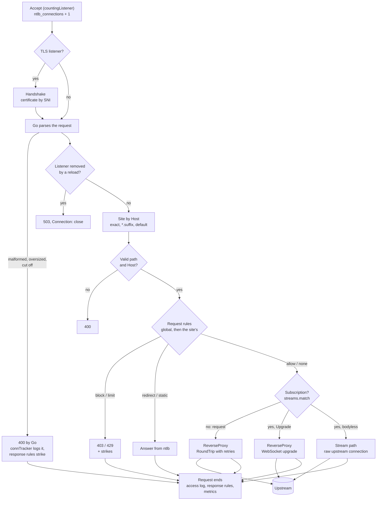

gzip sits between `observe` and both answers and the proxy, so a static file and a proxied
response are compressed alike; the stream path unwraps it, as subscriptions are never compressed.

## Balancing

`Pick(site, key)` returns the upstreams to try, best first; the first is the choice, the rest are
the retries. Draining upstreams are never picked; unhealthy ones only if no upstream is healthy
(fail open).

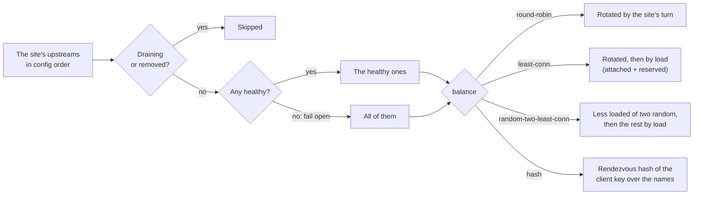

Within an upstream, a new request goes to the address with the fewest streams plus reserved
attempts, skipping addresses that failed recently or failed their last health check.

## Sequences

### A request, with a retry

A publish whose first upstream refuses the connection. A connection failure is retried for any
request, since it never reached a node; other errors only for idempotent methods, and a 503 only
if no body byte was sent.

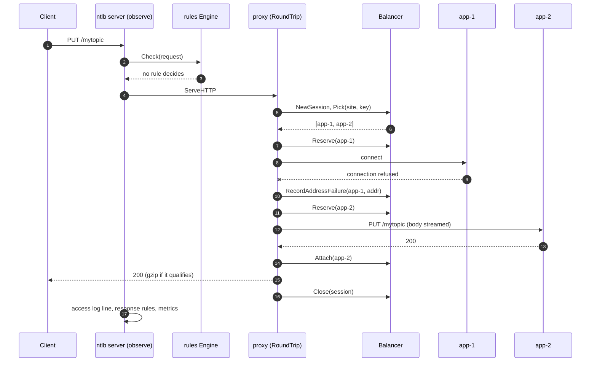

### An HTTP/1.1 subscription on the stream path

Subscriptions are idle almost all the time, and there are tens of thousands of them, so they skip
`ReverseProxy`: one raw upstream connection, a hijacked client connection, one goroutine, and no
buffer held while waiting.

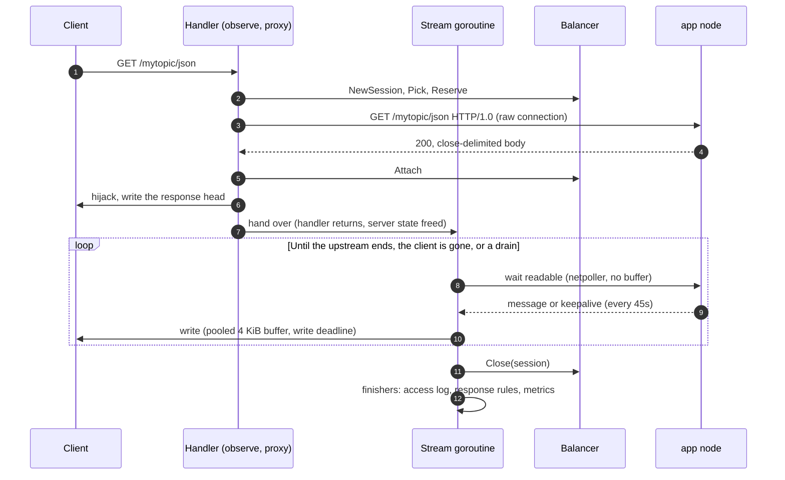

Over HTTP/2 the same upstream side is used, but the client side cannot be hijacked: the handler
writes through the `ResponseWriter` and flushes every write.

### A WebSocket

Upgrades stay on `ReverseProxy`, which hijacks the client connection after the 101 and copies
both ways. ntlb wraps the upstream side to bound idleness in both directions, to end the client
side when the upstream closes, and to use small copy buffers (ntfy's clients send tiny frames).

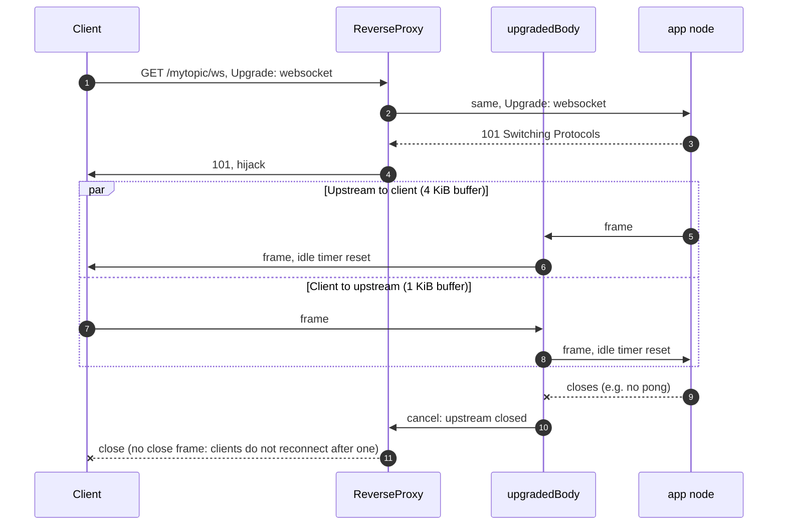

### Draining an upstream

`ntlb upstream drain app-1 -d 10m`, or app-1 removed from the config: its streams close oldest
first, spread evenly over the duration, so its clients reconnect at a steady rate instead of all
at once. New requests already avoid it.

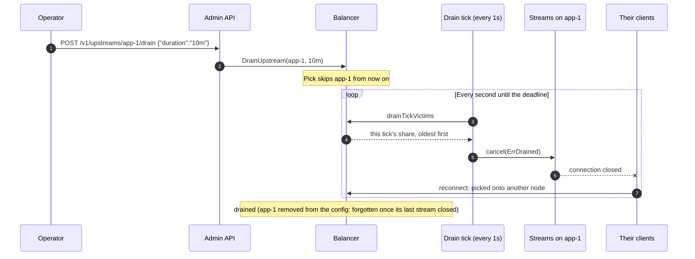

### Draining the load balancer (SIGTERM)

On shutdown (or `ntlb drain`) ntlb turns unready and turns away new subscriptions (so clients go
to another load balancer instead of being drained again), but keeps serving publishes until it is
drained.

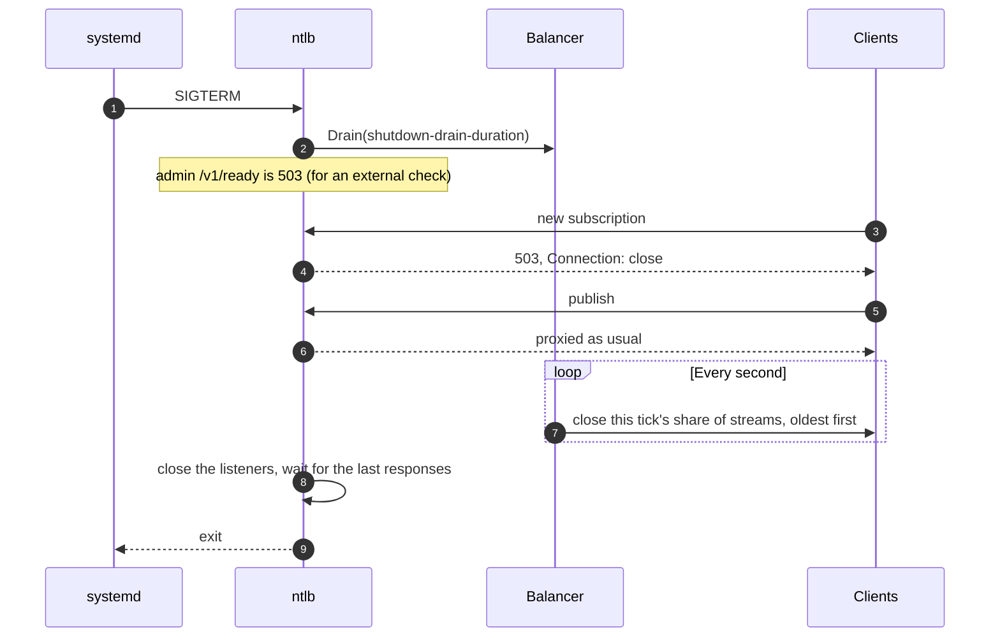

### A reload

`SIGHUP`, `systemctl reload ntlb` or `ntlb reload`. Everything that can fail is opened first, so a
broken config, certificate, log path or listen address rejects the reload and changes nothing.
Streams to upstreams that stay are not touched.

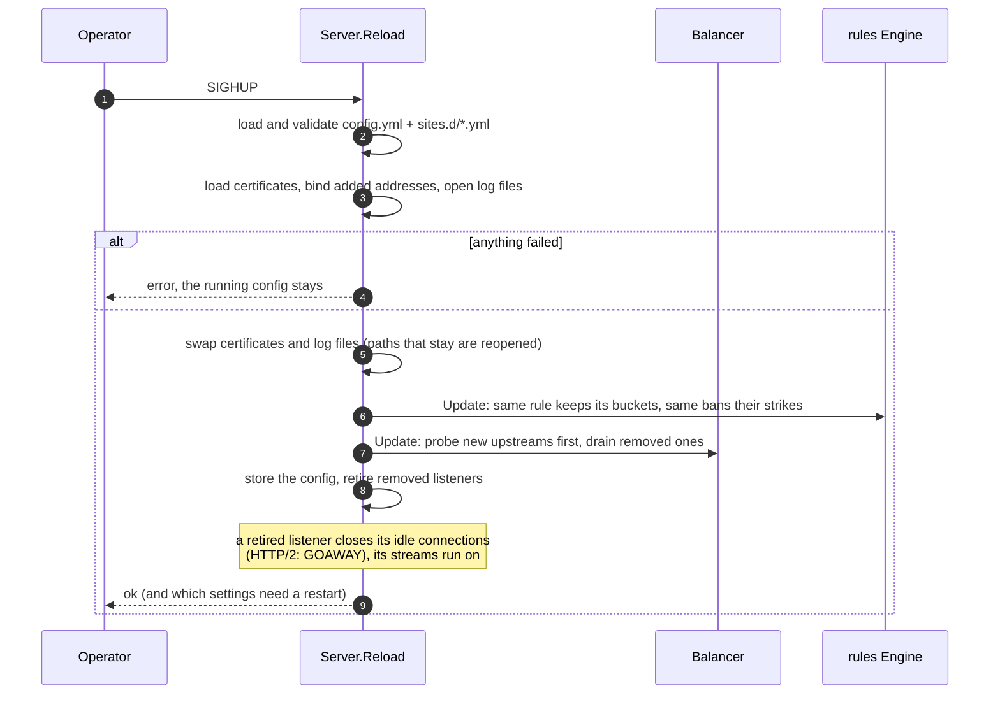

### Health checks

Every address of every upstream is probed each interval. An upstream is up if any address is;
hysteresis keeps it from flapping. The first probe decides directly, so a node that is down or
draining when ntlb starts, or when a reload adds it, never gets traffic.

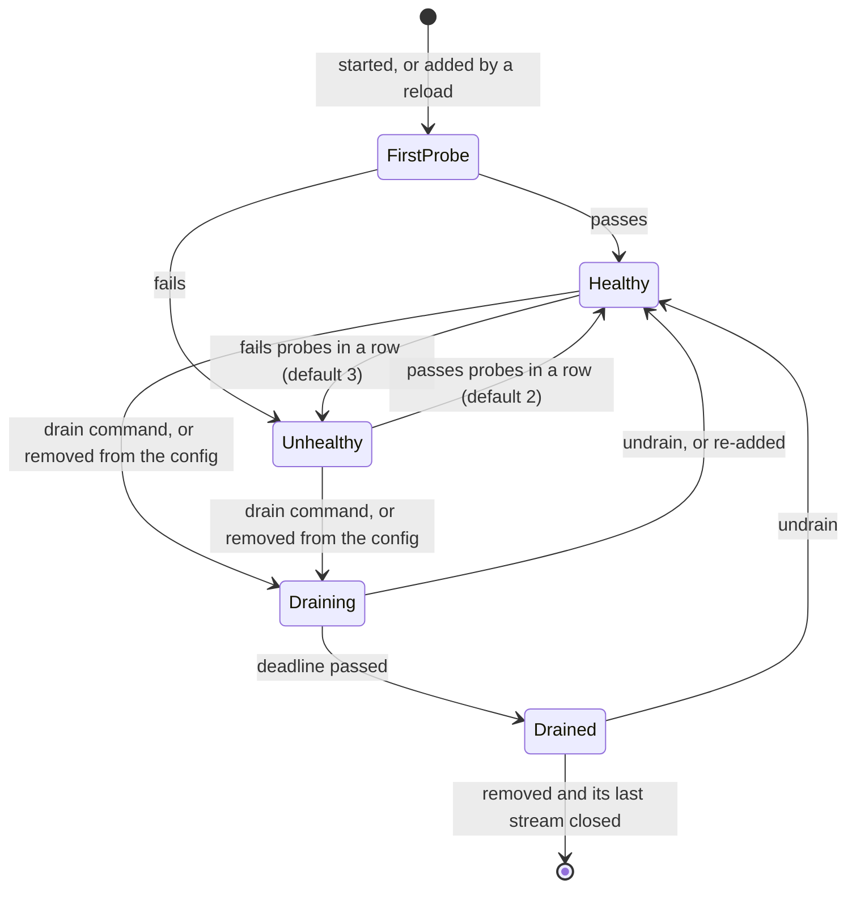

A probe is `GET http://<address><path>` on a new connection; 2xx and 3xx pass (redirects are not
followed). The ntfy site probes `/v1/ready`, which is 503 while a node drains.

### An upstream goes bad

What clients see depends on how the node breaks. The README's
[health check section](configuration.md#health-checks-and-what-happens-when-one-goes-bad) has the
timings; these are the paths.

**The node dies** (connections refused or reset). Requests notice before the health checks do:
a connect error never reached the node, so any request moves on, first to the node's other
addresses (each failed one backs off 1s, doubling to 30s), then to the next upstream.

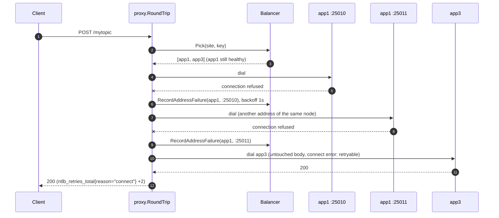

**The node hangs** (accepts, never answers). Nothing fails fast, so requests wait for
`upstreams.<name>.timeouts.read` and get 504; they are not retried, since the node may have acted on them.
The probes time out too, and after `fails` rounds the node is out and new requests skip it.

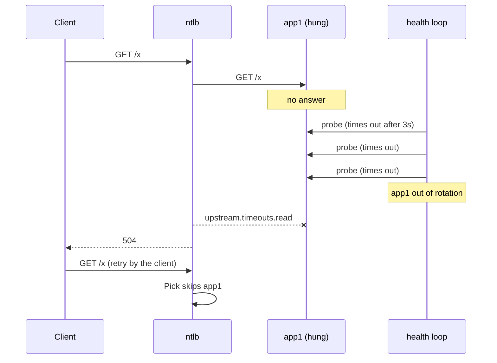

**Streams on a bad node** are never moved by health: an open stream stays on its node until its
connection ends or a drain closes it. On a dead node the connection ends by itself (a reset, or
TCP keepalive after `idle + interval * count`), the client reconnects, and its new request picks
a healthy node. A node that fails its probes but still serves (say, readiness 503 because its
database is slow) keeps its streams; drain it to move them.

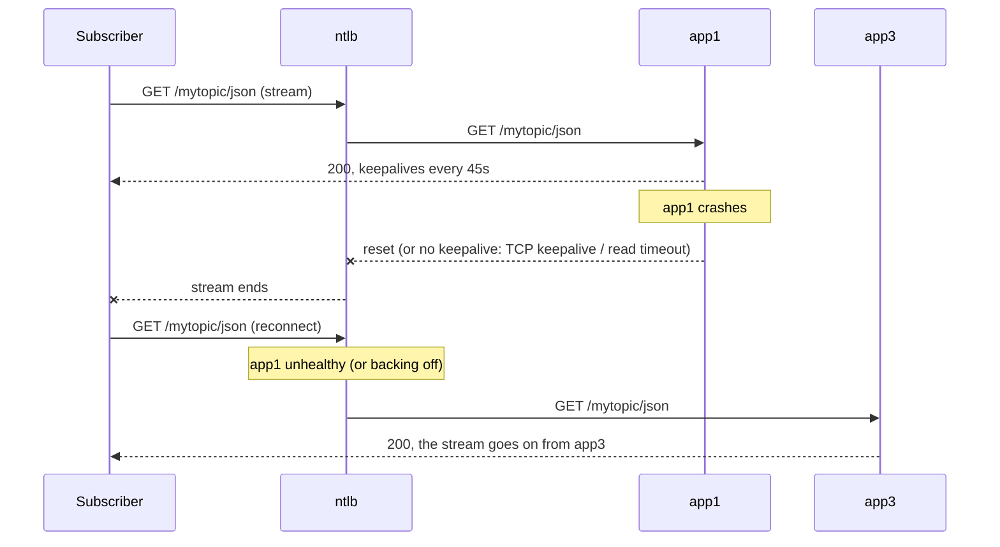

**Every node is bad.** `Pick` fails open: all upstreams that are not draining, in balance
order, so a shared problem (the database) degrades instead of turning everyone away. The admin
`/v1/health` and `/v1/ready` answer 503 meanwhile, for monitors and anything in front.

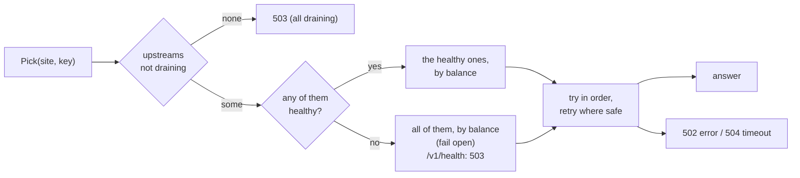

### Rules, strikes and bans

Rules decide a request before it is proxied (block, limit, allow, redirect, static, proxy), and response
rules look at the outcome. Both can add strikes per client; a client over the threshold within the
window gets one line in the ban file, which CrowdSec turns into a firewall ban on every host.

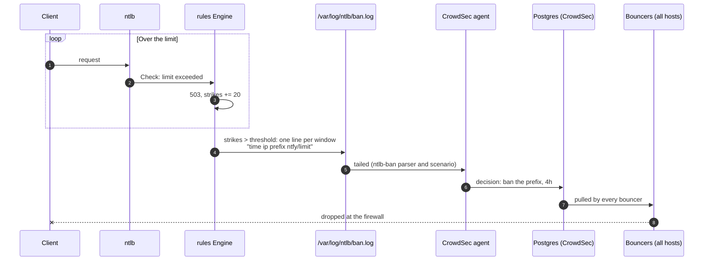

The access logs, partitioned like nginx's were (400s ntlb answered itself, 413, 5xx, abuse),
feed the other CrowdSec scenarios the same way.

## Concurrency and ownership

- `Balancer.mu` protects the upstream map, sessions and drains; `Upstream.mu` one upstream's
  addresses, counts and health. The order is always `Balancer.mu`, then `Upstream.mu`. The drain
  tick collects its victims under the lock and cancels them outside it, and scans the sessions
  only while something drains.
- The config, the proxy's transport and the rule state are swapped atomically on reload
  (`atomic.Pointer`); a request keeps the config it started with, a stream the upstream it
  attached to.
- Per-request cleanup is a list of finishers on the `proxyRequest`, run once by whoever ends the
  request: the handler, or the stream goroutine of a detached stream.
- Goroutines per connection: an HTTP/1.1 stream has one (the copy), an HTTP/2 stream its handler,
  a WebSocket the reverse proxy's two copiers. The health loop and the drain loop are one each,
  plus a flusher per log file; probes run in short-lived goroutines per round.
