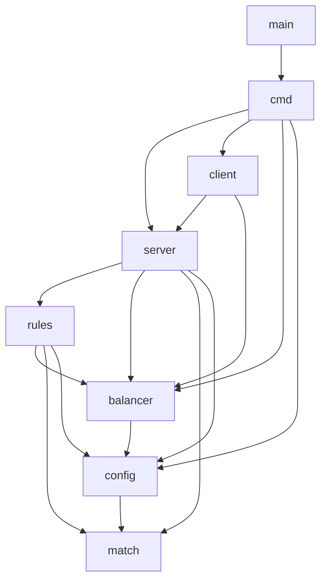
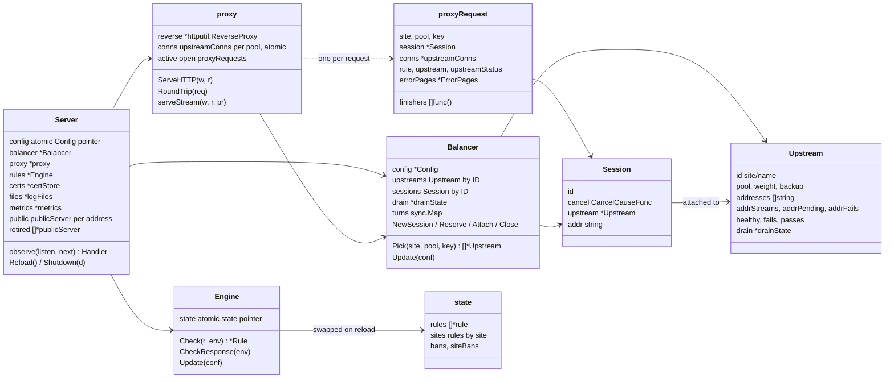
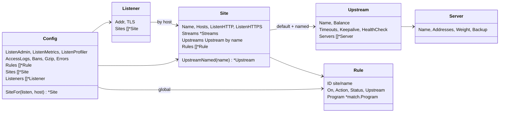
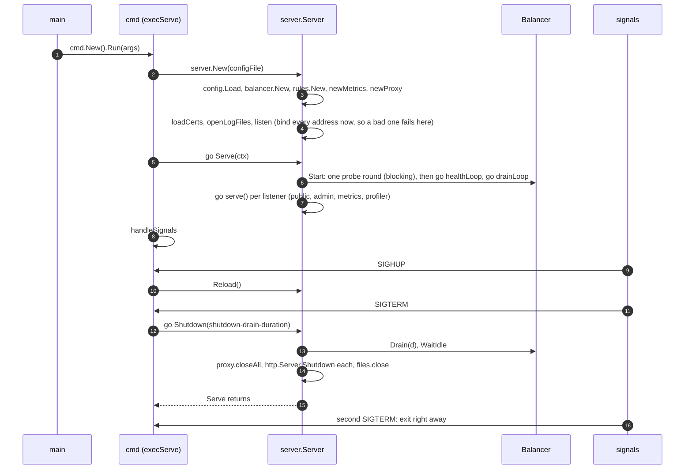
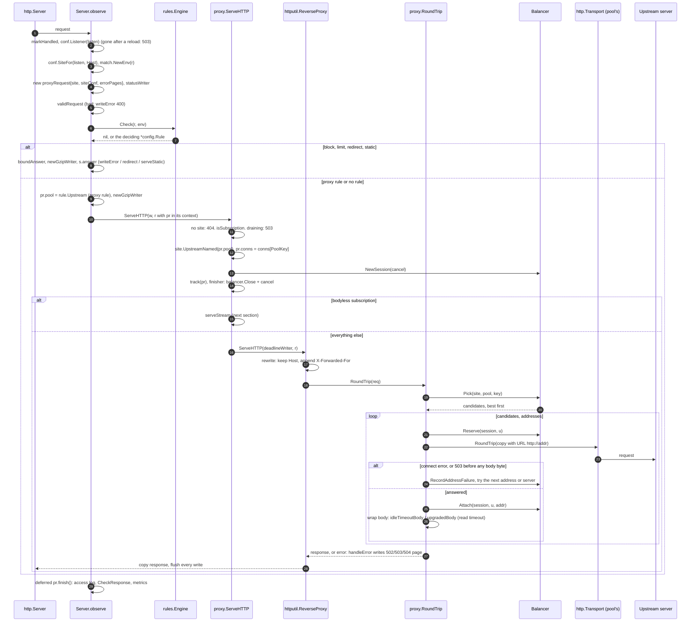
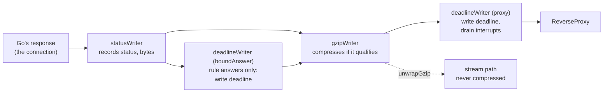
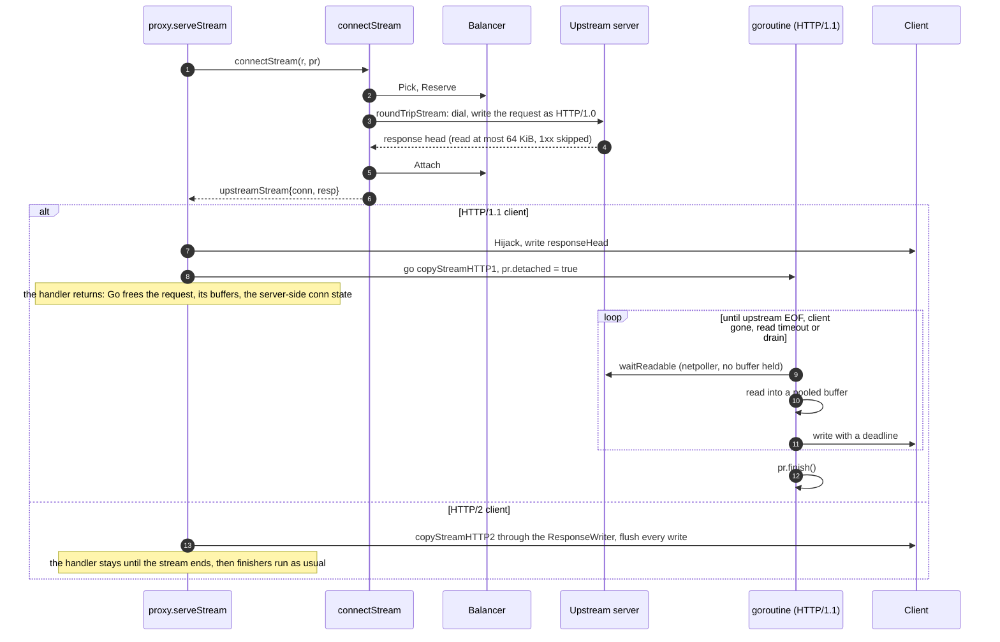
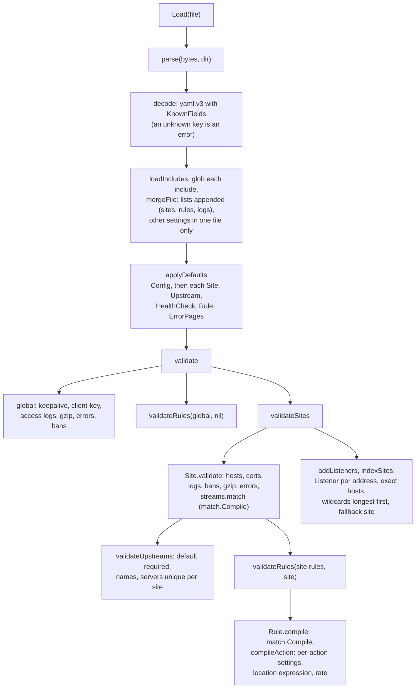
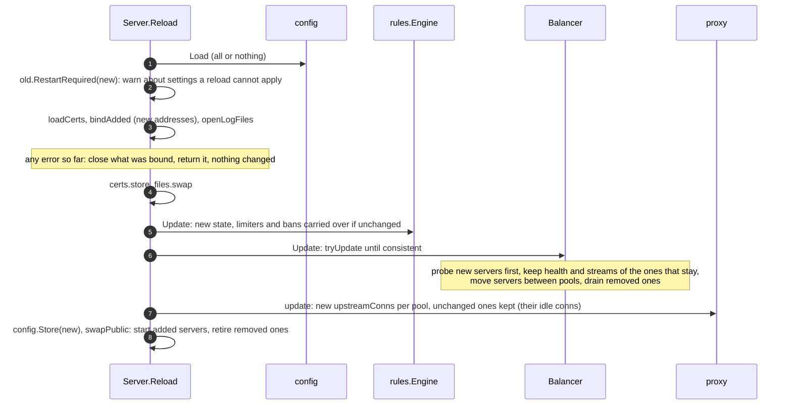
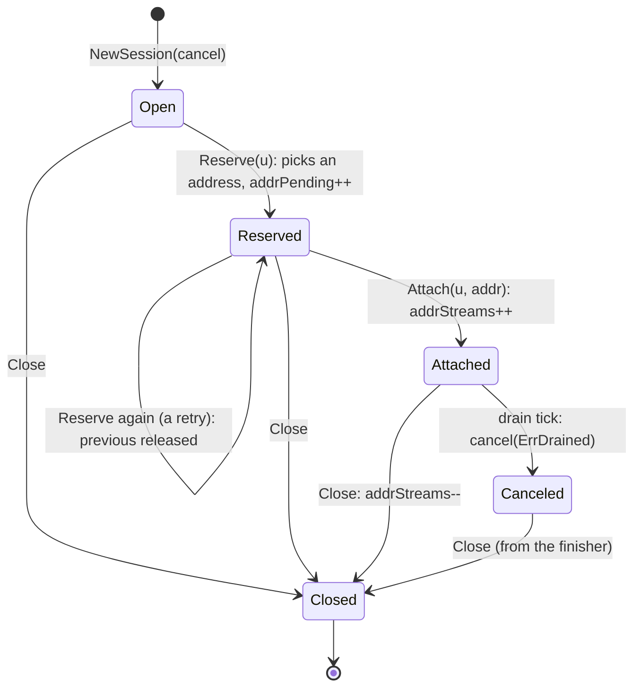

# ntlb code walkthrough

How the code is laid out and how a request, a stream, a reload, a health check and a drain move
through it, with the real function names, so you can read along in the source. What the system
does (deployment, behavior, the flows as an operator sees them) is in
[architecture.md](architecture.md); the invariants, numbers and lab results are in
[design.md](design.md); every setting is in [configuration.md](configuration.md).

- [Where to start reading](#where-to-start-reading)
- [Packages](#packages)
- [The main types](#the-main-types)
- [Process lifecycle](#process-lifecycle)
- [A request, function by function](#a-request-function-by-function)
- [The stream path](#the-stream-path)
- [The per-request state and its finishers](#the-per-request-state-and-its-finishers)
- [Loading and validating the config](#loading-and-validating-the-config)
- [A reload](#a-reload)
- [The balancer](#the-balancer)
- [The rules engine and expressions](#the-rules-engine-and-expressions)
- [Background goroutines](#background-goroutines)
- [Locks and what they protect](#locks-and-what-they-protect)
- [Tests](#tests)

## Where to start reading

About 7,300 lines of Go without tests. In this order, each step builds on the one before:

1. `config/config.go`, `config/sites.go`, `config/upstreams.go`, `config/rules.go`: the types everything else consumes.
   Skim the structs and their comments; the validation can wait.
2. `server/server.go`: `New`, `Serve`, `Reload`, `Shutdown`, and above all `observe`, the handler
   every public request enters.
3. `server/proxy.go`: `proxy.ServeHTTP` (the part after the rules), then `proxy.RoundTrip` and
   `tryUpstreams` (picking and retrying upstreams).
4. `balancer/service.go`: `Pick`; `balancer/session.go`: `NewSession`, `Reserve`, `Attach`, `Close`.
5. `server/stream.go`: the separate path for subscriptions.
6. `rules/service.go` and `match/match.go`: rules and the expression language.
7. `balancer/health.go`, `balancer/drain.go`: the two background loops.

## Packages

| Package | Files | Role |
|---|---|---|
| `main` | `main.go` | Calls `cmd.New().Run`. Nothing else. |
| `cmd` | `app.go`, `serve.go`, `status.go`, `drain.go` | The CLI (urfave/cli v3): `serve` runs a `server.Server` and handles signals; `check-config` loads a config; `status`, `reload`, `drain`, `undrain`, `upstream drain/undrain` talk to the admin API through `client`. |
| `client` | `client.go` | HTTP client for the admin API, used by the CLI. Shares the response types with `server` and `balancer`. |
| `server` | `server.go` and 16 more | Everything HTTP: `observe` (site, validation, rules, logs, metrics), the listeners (`listeners.go`), the reverse proxy and its retries (`proxy.go`), the stream path (`stream.go`), the body and connection wrappers that bound reads and writes (`wrappers.go`), answers by rules (`rules.go`), error pages, gzip, access logs, certificates, metrics, the admin API. |
| `balancer` | `service.go`, `session.go`, `strategy.go`, `hash.go`, `health.go`, `drain.go`, `types.go` | The state of the upstreams: which are healthy, which are draining, the open sessions, and the order to try them in. No HTTP serving, only the health probes. |
| `rules` | `service.go`, `bans.go` | The rule engine: checks a request against the rules, keeps the token buckets of `limit` rules and the strikes towards bans. |
| `match` | `match.go` | The expression language (on [expr](https://expr-lang.org)): compiles `match:` and `location:` strings, evaluates them against a request (`Env`) or an outcome (`ResponseEnv`). |
| `config` | `config.go`, `sites.go`, `upstreams.go`, `rules.go`, `errorpages.go` | Parses the YAML (and included files), applies defaults, validates, compiles the expressions, indexes the sites by listener and host. A `*config.Config` is immutable once loaded. |
| `lab/replay` | `main.go` | Not part of the binary: sends the same requests to ntlb and nginx and compares the answers. |

How they import each other (arrows point at the imported package). `config` and `match` are
the leaves; `server` is the only package that knows about all the others.

`rules` imports `balancer` only for `balancer.ClientKey` (the IPv4 /32 or IPv6 /64 a client is
counted by), and `client` imports `server` only for the admin API's response types.

External libraries: `expr-lang/expr` (expressions), `prometheus/client_golang` (metrics),
`urfave/cli/v3` (CLI), `gopkg.in/yaml.v3` (config). TLS, HTTP/1.1, HTTP/2, the reverse proxy and
WebSockets are the standard library's.

## The main types

Who holds what. A `Server` owns one of each service; the config is swapped as a whole on reload,
so every request reads the `*config.Config` it started with.

The config side, as `config.Load` returns it:

Two things share the name "upstream": a `config.Upstream` is a block in `upstreams:` (a pool,
with its balance, timeouts and health check), a `balancer.Upstream` is one server of it (one
node with its addresses). The balancer keys servers by `site/name`; per-pool state (round-robin
turns, the proxy's connection pools) by `balancer.PoolKey(site, pool)`, also `site/name`.

## Process lifecycle

The first probe round runs before any listener serves, so no request goes to a node that is down
at start.

## A request, function by function

Every public listener's `http.Server` has the handler `s.observe(listenAddr, s.proxy)`. `observe`
does everything that applies to all requests; `proxy.ServeHTTP` only runs for requests that are
proxied.

What is retried mirrors nginx's `proxy_next_upstream error timeout http_503`. One loop,
`tryUpstreams`, decides it for both the reverse proxy (`RoundTrip`) and the stream path
(`connectStream`):

| Failure | Retried? |
|---|---|
| Connection refused or reset before sending (`dialError`) | Yes, any method: first the server's other addresses, then the next server |
| Another error (timeout, reset after sending) | Only idempotent methods, and only if no body byte was sent |
| A 503 answer | Only if no body byte was sent, and not on the last candidate |
| A body partly sent | Never: there is no copy of it (`trackingBody`, `attemptBody.retire`) |

The writers wrap each other, outside in. Each layer exists for one reason:

Every wrapper has `Unwrap`, so `http.NewResponseController` still reaches `Flush` and `Hijack`
of the real connection.

## The stream path

Subscriptions (`streams.match`, bodyless `GET`, no `Upgrade`) skip `ReverseProxy`: there are
tens of thousands of them, idle almost all the time, and the reverse proxy would hold buffers
and goroutines for each. `proxy.serveStream` in `server/stream.go`:

A drain cancels the request context; `context.AfterFunc` callbacks then close the upstream
connection and the client side (`client.Close`, or `clientConn.interrupt` for HTTP/2), so a
blocked read or write returns at once. WebSockets (`Upgrade`) stay on `ReverseProxy`, with
`upgradedBody` bounding idleness both ways.

## The per-request state and its finishers

`proxyRequest` (`server/proxy.go`) is created by `observe` and travels in the request context
(`withProxyRequest`, `proxyRequestFromContext`), so `RoundTrip` and `handleError` find it. It
carries what the access log, the metrics and the response rules need at the end: site, pool,
rule, upstream, upstream status, kind.

Cleanup is a list of finishers (`onFinish`), run once, in reverse order, by `finish`:

| Registered by | Does |
|---|---|
| `observe` | the access log line, `rules.CheckResponse` (strikes), `metrics.observe` |
| `proxy.ServeHTTP` | `balancer.Close(session)`, cancel the request context |
| `proxy.ServeHTTP`, subscriptions | the streams gauge, and why the stream closed (drained, read timeout) |
| `proxy.track` | remove from `proxy.active` (what `Shutdown` waits for) |
| `serveStream` | close the upstream connection |

Who calls `finish`: `observe`'s deferred function, unless the stream path detached the request
(`pr.detached`); then the stream goroutine does, when the stream ends, possibly hours after the
handler returned. That is why the finishers must not touch the `statusWriter` (it references
the server's per-connection state): they read `pr.status`, recorded before.

## Loading and validating the config

`config.Load(file)` is all or nothing: it returns a fully defaulted, validated and compiled
`*Config`, or an error and nothing.

Validated also means compiled: every `match:` is a `*match.Program`, every `location:` too, the
rate of a `limit` is a float, an error page template is parsed. The request path never parses
anything.

## A reload

`Server.Reload` (from SIGHUP, `ntlb reload` or `POST /v1/reload`), serialized by `reloadMu`:

Requests in flight keep the old `*Config` and the old `upstreamConns` they loaded. A request
routed by the new rules may meet a site of the old config that lacks its pool; `proxy.ServeHTTP`
answers that with 502 (`upstream not configured`) instead of guessing.

## The balancer

`Balancer` (`balancer/service.go`) is the only shared mutable state on the request path besides
the rule buckets.

**Pick** (`Pick(site, pool, key)`): under the read lock, walk the servers in config order, keep
those of the site's pool that are not removed or draining, split them into healthy, healthy
backups, unhealthy, unhealthy backups, and return the first non-empty set sorted by the pool's
balance (`sortFor` in `strategy.go`), backups last. No healthy server at all: the unhealthy ones
(fail open). Nothing only if all are draining or the pool is gone.

| `balance` | Order (`strategy.go`, `hash.go`) |
|---|---|
| `round-robin` | `rotate` by the pool's turn (`nextTurn(PoolKey)`, an atomic counter), weighted |
| `least-conn` | rotated, then stable-sorted by `load()` (attached + reserved) per weight |
| `random-two-least-conn` | `sortRandomTwo`: the less loaded of two weighted random draws first |
| `hash` | `rankWeighted`: rendezvous hash of the client key and each server name (FNV-1a plus a bit mixer), the same on every load balancer |

**Sessions** track what is in flight, so drains can close it and least-conn can count it:

Within a server, `nextAddressNoLock` picks the address with the fewest streams plus pending
attempts, skipping addresses that failed recently (`addrRetry`, backoff 1s doubling to 30s) or
failed their last probe (`addrDown`), unless all of them did.

**Update** (`tryUpdate`): computes the new server set; servers that stay keep their `*Upstream`
(health, counters, streams) and only take the new weight, backup, pool and addresses; new ones
are probed outside the lock before they are added; removed ones get a drain over
`drain-duration` and are forgotten by the drain tick once empty. If the world changed while it
probed (a removed server was forgotten meanwhile), it starts over.

## The rules engine and expressions

`rules.Engine` (`rules/service.go`) holds one `state` behind an `atomic.Pointer`; `Update`
builds a new one per reload.

- **Check** walks the global rules, then the site's (`rulesFor`), skips response rules and
  non-matching ones, and returns at the first that decides: `allow` returns nil (proxy to the
  default upstream), `block`, `redirect`, `static`, `proxy` return the rule, `limit` only if its
  bucket is empty (`limiter.take`), otherwise checking goes on.
- **limiter**: a token bucket per client key (IPv4 /32, IPv6 /64), refilled by elapsed time on
  each take, swept every so often. Kept across a reload if name, rate, burst and client key are
  unchanged (`reusableLimiter`).
- **Strikes**: `block` and `limit` (when they decide) and every matching response rule
  (`CheckResponse`, at the end of a request) call `strike`, which adds the rule's weight to the
  client's leaky bucket in `bans` (`bans.go`); over the threshold within the window, one ban line
  per window goes to `onBan`, which is `Server.writeBan` (the ban file, which CrowdSec reads).

`match.Compile(expression, kind)` (`match/match.go`) compiles with expr against `Env` (request
rules, `streams.match`, `location`) or `ResponseEnv` (response rules, access log `match`), and
type-checks the result (bool, or string for `location`). The functions:

- `header(name)` and `flag(names...)` are plain expr functions that read the request kept in
  `Env` (`flag` parses the query once per request).
- `ipIn(ip, nets...)` is rewritten at compile time (the `networks` visitor): the network
  literals are parsed once into `netip.Prefix`, so a bad network fails the config, not a request.

`ResponseEnv` has no headers on purpose: it is built when the request starts
(`NewResponseEnv`) and used when it ends, possibly hours later, and must not keep the request.

## Background goroutines

| Goroutine | Started by | Does |
|---|---|---|
| `healthLoop` | `Balancer.Start` | wakes at the shortest health interval, `go probe(due servers)`: one goroutine per server, one per address, `applyProbes` with hysteresis |
| `drainLoop` | `Balancer.Start` | every second `drainTick`: picks this tick's sessions (oldest first, spread evenly to the deadline) under the lock, cancels them outside it, forgets drained removed servers |
| `accessLog.flushLoop` | per log file | flushes the buffered writer every second |
| `serve` | `Server.Serve`, `swapPublic` | one `http.Server` per listen address, plus admin, metrics, profiler |
| stream copy | `serveStream` | one per detached HTTP/1.1 stream |
| `handleSignals` | `execServe` | reload, shutdown |

Go's `http.Server` adds a goroutine per connection (and per HTTP/2 stream), the reverse proxy
two per WebSocket.

## Locks and what they protect

| Lock | Protects | Notes |
|---|---|---|
| `Balancer.mu` (RWMutex) | upstream map, order, sessions, drains, each upstream's pool, weight, backup, removed, drain | `Pick` takes the read lock; always taken before `Upstream.mu` |
| `Upstream.mu` | one server's addresses, per-address counts, health state | |
| `proxy.mu` | `active` (open requests, for `Shutdown`) | |
| `limiter.mu` | one limit rule's buckets | |
| `bans.mu` | one bans scope's strikes | |
| `Server.reloadMu` | serializes `Reload`, keeps it out of `Shutdown` | |
| `Server.mu` | public and retired servers, listeners | |
| `atomic.Pointer` | `Server.config`, `proxy.conns`, `proxy.config`, `rules.Engine.state` | swapped whole on reload, read without a lock |

Callbacks that cancel requests (drain ticks, `Attach` on a forgotten server) collect under the
lock and cancel outside it: a cancel runs `AfterFunc` callbacks that close connections.

## Tests

Colocated (`foo.go` and `foo_test.go`), `make` runs fmt-check, vet, the tests and the build;
`make race` the tests with `-race`.

- **server**: end-to-end over real sockets. `newTestServer(t, extra, upstreams...)` writes a
  config (`writeConfig`: lines of `extra` go to the site or the global section by key) and starts
  a `Server`; `newTestUpstream` is an `httptest`-style ntfy stand-in with handlers per path,
  `newRawUpstream` a TCP server for malformed answers. `TestServer_NtfyPackagedConfig` runs the
  packaged ntfy site (`packaging/sites.d/ntfy.yml`) against fake app nodes.
- **balancer**: `Pick`, strategies, hashing (including how few clients move when a server
  leaves), health hysteresis, drain pacing (the tick functions take `now`, so tests pass the
  times they need).
- **config**: parsing, defaults, every validation error, the packaged configs.
- **Fuzz targets**: `FuzzParse` (config), `FuzzCompile` (expressions), `FuzzAccessLog_Escape`,
  `FuzzAccessLog_RedactAuth`, `FuzzRankWeighted`. Run one with
  `go test ./config -run '^$' -fuzz FuzzParse -fuzztime 5m`.
- **Benchmarks**: `BenchmarkMatch`, `BenchmarkMatch_HeaderAndFlag` (expressions),
  `BenchmarkEngine_Check`, `BenchmarkEngine_CheckParallel` (rules), `BenchmarkProxy_NtfyPublish`
  (a publish end to end).
- **lab/replay**: compares ntlb with nginx on the lab VMs; see design.md for the lab setup and
  results.
