# Configuration

Every setting of ntlb, the expression language, and recipes. The [README](../README.md#configuration)
has the short version; [packaging/config.yml](../packaging/config.yml) and
[packaging/sites.d/ntfy.yml](../packaging/sites.d/ntfy.yml) are a complete, commented example (the
ntfy.sh setup). How it works inside is in [architecture.md](architecture.md) and
[design.md](design.md).

- [Config files](#config-files)
- [Global settings](#global-settings)
- [Sites](#sites)
- [Upstreams and balancing](#upstreams-and-balancing)
- [Health checks, and what happens when one goes bad](#health-checks-and-what-happens-when-one-goes-bad)
- [Streams](#streams)
- [Access logs](#access-logs)
- [Rules](#rules)
- [Bans](#bans)
- [Compression](#compression)
- [The expression language](#the-expression-language)
- [Recipes](#recipes)
- [Running as a regular user, and certificates](#running-as-a-regular-user-and-certificates)

## Config files

ntlb reads one YAML file, `/etc/ntlb/config.yml` by default (`--config`). It can `include` more
files, which are merged into it as if they were one big file:

```yaml
# /etc/ntlb/config.yml
listen-admin: "127.0.0.1:2590"
include: [sites.d/*.yml, rules.d/*.yml]   # relative to this file's directory
```

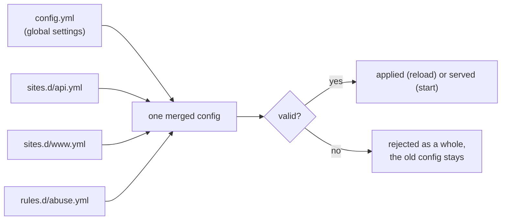

- **Merging**: lists (`sites`, `rules`, `access-logs`) are appended in order: the main file first,
  then each glob's files sorted by name. Every other setting may be set in one file only. Only the
  main file may include.
- **Validation**: unknown keys, bad expressions, duplicate names and the like are errors, with the
  YAML line or the rule and the position in its expression. `ntlb check-config` checks a file without touching the running server.
- **Reload**: `systemctl reload ntlb` (SIGHUP) or `ntlb reload` re-reads all files. Everything
  applies without cutting a stream (sites, upstreams, rules, certificates, logs, listen addresses)
  except `listen-admin`, `listen-metrics`, `listen-profiler` and `client-keepalive`, and an address
  that switches between `listen-http` and `listen-https`: those need a restart, and `ntlb reload`
  lists them if they changed.
- **Durations** are Go durations: `500ms`, `45s`, `5m`, `1h30m`. They must be positive.
- **Names** of sites, upstreams and rules are 1-64 of `a-z A-Z 0-9 - _ .`.

## Global settings

| Setting | Default | |
|---|---|---|
| `listen-admin` | `127.0.0.1:2590` | Admin API, `/metrics`, `/debug/pprof/`. **No auth**: keep it local. |
| `listen-metrics` | off | Only `/metrics`, e.g. on a private network for Prometheus. |
| `listen-profiler` | off | Only `/debug/pprof/`, to profile under load without exposing the admin API. |
| `access-logs` | none | Access logs for sites without their own, and for requests no site serves. See [Access logs](#access-logs). |
| `client-keepalive` | `{idle: 1m, interval: 15s, count: 4}` | TCP keepalive towards clients; a dead peer is noticed after `idle + interval * count`. `{disable: true}` turns it off. |
| `upstream-keepalive` | `{idle: 1m, interval: 15s, count: 4}` | The same towards upstreams. |
| `upstream-connect-timeout` | `5s` | An address that does not accept within this is down for this request; the next one is tried. |
| `upstream-read-timeout` | `60s` | Cut a response (or a WebSocket) after this long without a byte. Streams need their upstream to send keepalives within it. |
| `drain-duration` | `5m` | Default for `drain` commands, and for upstreams removed from the config. |
| `shutdown-drain-duration` | `2m` | On SIGTERM: not ready right away, streams closed over this long, then exit. |
| `client-key` | `{ipv4-prefix-bits: 32, ipv6-prefix-bits: 64}` | What identifies a client for `balance: hash`, limits and bans: its IP, shortened to a prefix. |
| `bans` | off | Strike counting and the ban file. See [Bans](#bans). |
| `gzip` | off | Compression for sites without their own. See [Compression](#compression). |
| `rules` | none | Global rules, checked for every request before its site's rules. See [Rules](#rules). |
| `include` | none | Globs of files to merge in. |
| `sites` | required | At least one. See [Sites](#sites). |

A minimal config, one site in front of two app servers:

```yaml
sites:
  - name: app
    listen-http: ":80"
    upstreams:
      - name: app1
        addresses: ["10.0.0.11:8080"]
      - name: app2
        addresses: ["10.0.0.12:8080"]
```

That balances round-robin, probes `GET /` on every address every 5s, proxies WebSockets and
HTTP/1.1 and keeps everything else at its default.

## Sites

A site is a set of listen addresses and host names, with its own certificate, upstreams, health
check, streams, rules and (optionally) logs, bans and gzip settings.

| Setting | Default | |
|---|---|---|
| `name` | required | Used in logs (`site=`), metrics, the CLI, and as the prefix of its rules' names. |
| `listen-http` | | One address or a list: `":80"`, `"10.0.0.1:80"`, `["[::]:80", "0.0.0.0:8080"]`. |
| `listen-https` | | The same, for TLS (HTTP/2 and HTTP/1.1). Needs `cert-file` and `key-file`. |
| `hosts` | all | Host names this site serves: exact (`example.com`) or wildcard (`"*.example.com"`: any subdomain). Leave out to take every host no other site on these addresses serves. |
| `cert-file`, `key-file` | | PEM certificate (full chain) and key, re-read on every reload. |
| `upstreams` | required | See [Upstreams and balancing](#upstreams-and-balancing). |
| `balance` | `round-robin` | `round-robin`, `least-conn`, `random-two` or `hash`. |
| `health-check` | `{path: /, interval: 5s, timeout: 3s, fails: 3, passes: 2}` | See [Health checks](#health-checks-and-what-happens-when-one-goes-bad). |
| `streams` | none | Which requests are long-lived streams. See [Streams](#streams). |
| `rules` | none | Checked after the global rules; named `<site>/<name>` in logs and metrics. |
| `access-logs`, `bans`, `gzip` | the global ones | Replace the global setting for this site's requests. |

Several sites can share listen addresses. A request goes to a site by its `Host` header (port and
trailing dot ignored, case-insensitive):

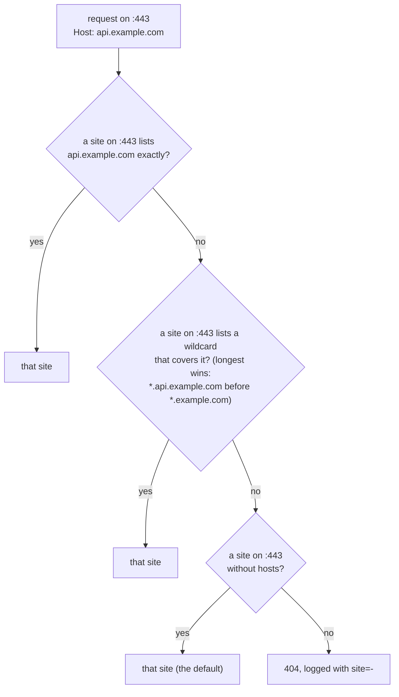

On HTTPS, the certificate is the one of the listener's site that matches the client's SNI the same
way, else the listener's first site's.

```yaml
# Two sites on the same addresses, plus a catch-all
sites:
  - name: www
    listen-http: ":80"
    listen-https: ":443"
    hosts: [example.com, www.example.com]
    cert-file: /etc/ntlb/certs/example.com/fullchain.pem
    key-file: /etc/ntlb/certs/example.com/privkey.pem
    upstreams:
      - {name: web1, addresses: ["10.0.0.21:3000"]}
  - name: api
    listen-http: ":80"
    listen-https: ":443"
    hosts: ["*.api.example.com", api.example.com]
    cert-file: /etc/ntlb/certs/api.example.com/fullchain.pem
    key-file: /etc/ntlb/certs/api.example.com/privkey.pem
    balance: least-conn
    upstreams:
      - {name: api1, addresses: ["10.0.0.31:8080"]}
      - {name: api2, addresses: ["10.0.0.32:8080"]}
  - name: default                     # every other host on :80 and :443
    listen-http: ":80"
    listen-https: ":443"
    cert-file: /etc/ntlb/certs/example.com/fullchain.pem
    key-file: /etc/ntlb/certs/example.com/privkey.pem
    upstreams:
      - {name: web1, addresses: ["10.0.0.21:3000"]}   # names are per site
    rules:
      - name: unknown-host
        action: block                 # no match: every request
        status: 404
```

## Upstreams and balancing

An upstream is one backend node with one or more addresses. An address may be a port range,
`"10.0.0.11:25010-25017"`, which is one address per port (each address holds ~63k connections from
one source IP, so a node with many long-lived clients listens on several ports).

```yaml
upstreams:
  - name: app1
    addresses: ["10.0.0.11:8080"]
  - name: app2
    addresses: ["10.0.0.12:8080", "10.0.0.12:8081"]
  - name: app3
    addresses: ["10.0.0.13:25010-25017"]   # 8 addresses
```

Within an upstream, a request goes to the address with the fewest open requests that is neither
failing its health checks nor backing off after a failure.

`balance` decides which upstream:

| `balance` | Picks | Like nginx | Use it for |
|---|---|---|---|
| `round-robin` (default) | the next one in turn | (default) | similar nodes, short requests |
| `least-conn` | the fewest open requests on this load balancer, in turn among equals | `least_conn` | long or uneven requests with one load balancer |
| `random-two` | the less busy of two random ones | `random two least_conn` | uneven requests with several load balancers, which each see only their own load |
| `hash` | the same upstream for the same client, by `client-key` | `hash $remote_addr consistent` | per-client state on the node: rate limits, sessions, a pub/sub node per client |

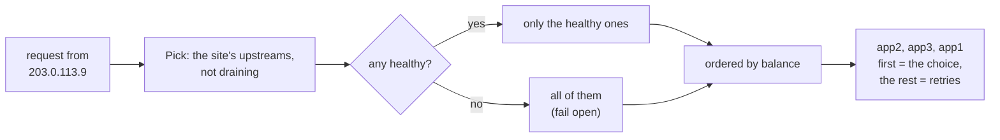

`hash` is rendezvous hashing over the upstream **names** (not the addresses): every load
balancer with the same names sends a client to the same node, and adding or removing a node only
moves the clients that ranked it first. Keep the names equal on all load balancers; renaming a
node moves its clients.

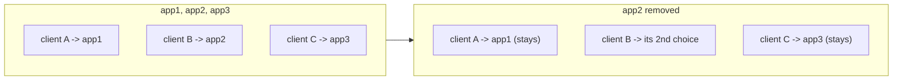

**Retries**, like nginx's `proxy_next_upstream error timeout http_503`: a request moves on to the
next address of the same node if it could not connect, then to the next upstream in the list:

- if it never reached the node (connect error): any request;
- on another error: only `GET`, `HEAD` and `OPTIONS`;
- on a 503 (e.g. a node that is shutting down): any request whose body was not sent yet.

A request whose body was partly sent is never resent (there is no copy). The last upstream's
answer or error goes to the client: `502` for an error, `504` for a timeout, `503` if every
upstream is draining.

## Health checks, and what happens when one goes bad

Every address of every upstream is probed every `interval`: `GET http://<address><path>` on a new
connection. Any `2xx` or `3xx` within `timeout` passes (redirects are not followed). An upstream
passes a round if **any** of its addresses passed; the addresses that failed are skipped while
others are up.

```yaml
health-check:
  path: /healthz    # default /
  interval: 5s
  timeout: 3s
  fails: 3          # failed rounds in a row before the upstream leaves the rotation
  passes: 2         # good rounds in a row before it comes back
```

The very first probe (at start, or when a reload adds an upstream or changes its addresses)
decides right away, so a node that is down then never gets traffic. After that, `fails` and
`passes` keep a slow probe or two from flapping it:

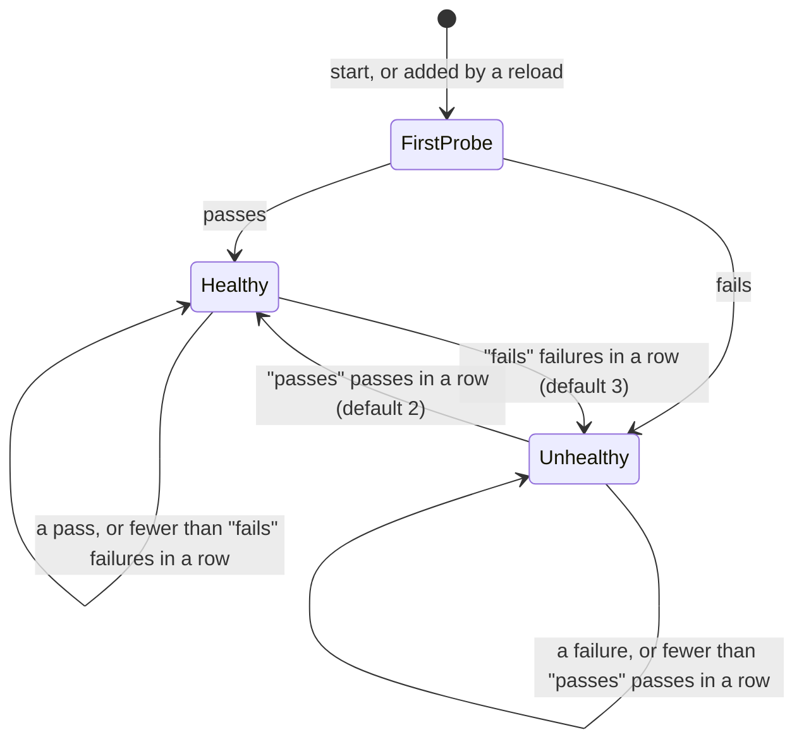

With the defaults, a node that dies leaves the rotation after 10-15s (3 probes, 5s apart; up to
3s more each if they hang) and comes back 5-10s after it recovers.

**What happens when a node goes bad**, step by step:

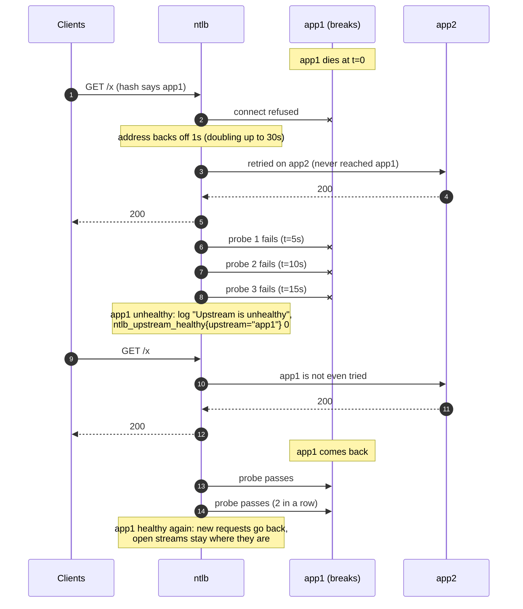

In detail:

| | While the node is still "healthy" (the first 10-15s) | Once it is unhealthy |
|---|---|---|
| New requests | Tried on it first; a connect error moves the request to its other addresses, then to the next upstream, so clients rarely notice. Each failed address backs off (1s, doubling to 30s). | Not sent to it. `hash` clients go to their second choice, `round-robin` and the others spread over the rest. |
| A node that accepts but hangs | Requests wait for `upstream-read-timeout`, then `504`. | Not sent to it. |
| Open streams and WebSockets on it | Stay open as long as their connection does. | Stay open: health never moves an open connection, only drains do. A dead node's connections end with a reset, or after the keepalive (`idle + interval * count`, 2m by default); the clients reconnect and land on a healthy node. |
| `ntlb status` | `healthy`, the last error in `NOTE` | `unhealthy`, with the probe error |
| Metrics, logs | `ntlb_retries_total` goes up | `ntlb_upstream_healthy` = 0, a warning log line |

When **every** upstream of a site is unhealthy, ntlb fails open: it tries all of them (minus the
draining ones), in balance order, because a problem they share (say, their database) is no reason
to turn every client away. The admin `/v1/health` and `/v1/ready` then answer 503, so a cloud load
balancer or monitor in front sees it.

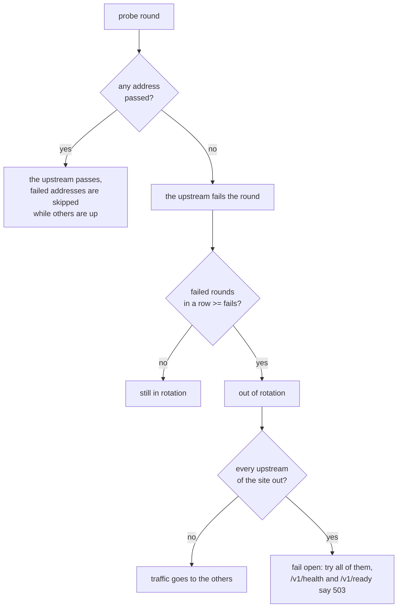

Health is not drain: a drain (`ntlb upstream drain app1`) closes the node's open streams over a
duration, and turns away nothing else until it is done. To take a node out for maintenance, drain
it; health checks are for when it breaks. A node whose readiness endpoint answers 503 while it
shuts down (like ntfy's `/v1/ready`) gets both: health takes it out of the rotation, and 503 answers
in the meantime are retried elsewhere.

## Streams

Long-lived requests (server-sent events, long-polls, chunked feeds) that a request expression
selects:

```yaml
streams:
  match: method == "GET" && path matches "^/events(/.*)?$" && !flag("once")
```

Streams take a low-memory path (the load balancer does not read from the client connection while
the upstream streams), a draining load balancer turns new ones away with 503, and drains close them
at an even pace, so their clients do not all reconnect at once. Only bodyless requests can be
streams. WebSocket upgrades need no setting: every upgrade is handled as one. Default: no
streams.

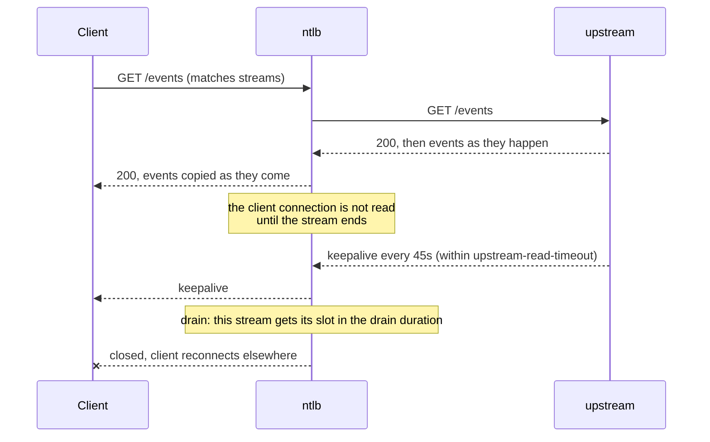

## Access logs

One line per request, in nginx's `combined` format plus key=value fields:

```
203.0.113.9 - - [10/Nov/2026:14:03:11 -0500] "GET /mytopic/json HTTP/2.0" 200 412 "-" "ntfy/1.21" http_host=ntfy.sh site=ntfy request_time=1834.201 upstream=app1:25012 upstream_status=200
```

A request goes to the **first** file whose `match` (a response expression) is true; an entry
without `match` takes the rest. A reload reopens the files (for logrotate).

```yaml
access-logs:
  - {file: /var/log/ntlb/blocked.log, match: 'rule != "" && status >= 400'}   # rules that blocked or limited
  - {file: /var/log/ntlb/bad.log, match: status == 400 && upstream_status == 0}   # unparseable requests
  - {file: /var/log/ntlb/access.log, match: status < 400}
  - {file: /var/log/ntlb/error.log}                                           # everything else
```

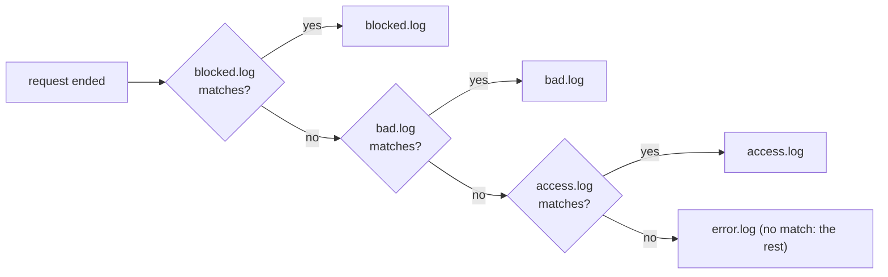

A site with its own `access-logs` writes there instead; requests that no site serves use the global
ones. A request the load balancer cannot parse (garbage, headers over 64 KiB, cut off mid-headers)
is logged as `"-" 400`. `auth=` query values are redacted.

## Rules

Rules decide what happens to a request before it is proxied (request rules), or count what happened
after (response rules, `on: response`).

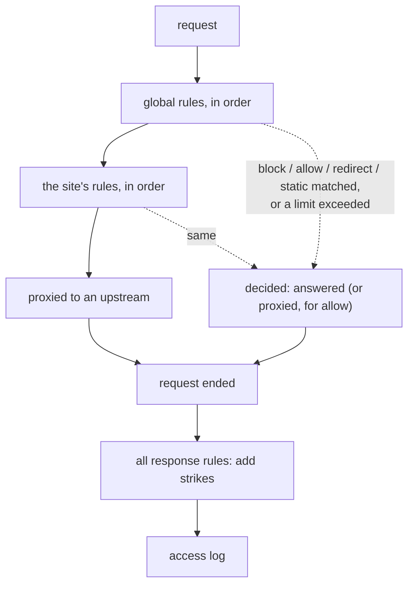

Request rules are checked in order, the global ones first. The first `block`, `allow`, `redirect`
or `static` whose `match` is true decides; a `limit` decides only when exceeded (under the limit,
checking goes on). A request no rule decides is proxied. A rule without `match` matches every
request.

| `action` | Settings | Does |
|---|---|---|
| `block` | `status` (default 403), `strike` | Answers `status` with a short text body. |
| `limit` | `rate` (required), `burst` (default 0), `status` (default 429), `strike` | A token bucket per client key and rule: `rate` requests per `s`, `m` or `h`, plus `burst` at once (nginx's `limit_req burst=N nodelay`). Over it, answers `status`; `strike` counts per limited request. |
| `allow` | none | Stops checking and proxies. For exemptions: put it before the rules it exempts from. |
| `redirect` | `location` (required, a string expression), `status` (default 302; 300-399) | Answers a redirect. |
| `static` | `root` (required), `fallback` | Serves the file at the request path under `root`, else `fallback` (a path under `root`, like nginx's `try_files $uri /index.html`), else 404. Directories serve the fallback. Paths with `.`, `..` or empty segments, dotfiles (so also `/.well-known/`) and symlinks out of `root` are refused. |

Response rules (`on: response`) take only `match` (a response expression) and `strike`, are all
checked when a request ends, and only add strikes towards a [ban](#bans).

Every action, in examples:

```yaml
rules:
  # block: scanners, with a 404 so they learn nothing, and strikes towards a ban
  - name: scanners
    match: path matches "(?i)\\.(php|asp|aspx|jsp|cgi)$" || path startsWith "/wp-"
    action: block
    status: 404
    strike: 10

  # allow: the office skips the limits below
  - name: office
    match: ipIn(ip, "198.51.100.0/24", "2001:db8:100::/48")
    action: allow

  # limit: a tight limit for logins, and a loose one for everything else
  - name: login-limit
    match: method == "POST" && path == "/login"
    action: limit
    rate: 5/m
    burst: 5
    strike: 5
  - name: limit
    action: limit
    rate: 600/m
    burst: 300
    strike: 1

  # redirect: a moved page, keeping the query string
  - name: old-blog
    match: path startsWith "/blog/"
    action: redirect
    status: 301
    location: '"https://blog.example.com/" + trimPrefix(path, "/blog/") + (query != "" ? "?" + query : "")'

  # static: a single-page app; /api/ falls through to the upstream
  - name: app
    match: method in ["GET", "HEAD"] && !(path startsWith "/api/")
    action: static
    root: /var/www/app
    fallback: /index.html

  # response: clients that keep hitting 404s
  - name: many-404
    on: response
    match: status == 404
    strike: 1
```

A rule with `strike` needs a [bans](#bans) section.

## Bans

Rules add strikes to a client (its client key). A client with more than `threshold` strikes
within `window` gets one line in the ban file, which [CrowdSec](https://crowdsec.net) (or fail2ban)
turns into a firewall ban:

```yaml
bans:
  file: /var/log/ntlb/ban.log
  window: 10m        # default
  threshold: 100     # required
```

```
2026-11-10T19:03:11Z 203.0.113.9 203.0.113.9/32 scanners
2026-11-10T19:04:52Z 2001:db8:1:2::77 2001:db8:1:2::/64 ntfy/limit
```

The fields are the time, the IP, the client key (its prefix) and the rule that tipped it over.

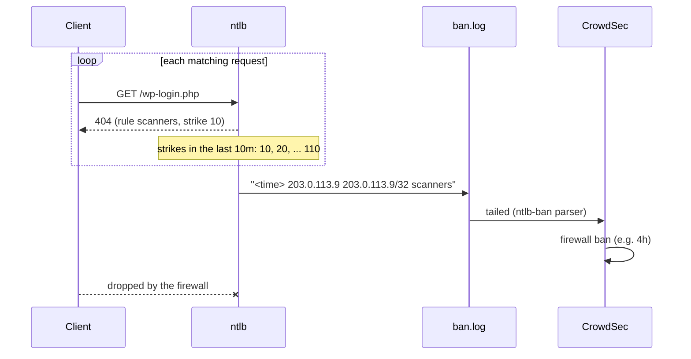

- A `strike` above `threshold` bans on the first match: `strike: 101` with `threshold: 100`.
- Strikes are counted per load balancer; the ban tool shares the bans between them.
- A site may have its own `bans`, which then counts its requests' strikes (global rules' too)
  separately.

## Compression

Like nginx's `gzip` with `gzip_proxied any`: level 6, responses of at least 1100 bytes, of the
listed media types, with status 200, 403 or 404, to HTTP/1.1+ clients that accept gzip, unless the
upstream encoded them already.

```yaml
gzip:
  types: [text/html, text/plain, text/css, application/javascript, application/json, image/svg+xml]
```

A streamed (flushed) response is compressed as it goes. Streams (`streams.match`), WebSockets and
`HEAD` requests never are. A site may have its own `gzip` instead. Default: off.

## The expression language

`match` (rules, streams, access logs) and `location` (redirects) are expressions in
[expr](https://expr-lang.org/docs/language-definition), the language CrowdSec's filters use. They
are compiled and type-checked when the config loads, so a typo is a config error, not a runtime
surprise.

There are three kinds:

| Kind | Used by | Result | Sees |
|---|---|---|---|
| request | request rules' `match`, `streams.match` | boolean | the request |
| response | response rules' `match`, `access-logs[].match` | boolean | the request (without headers) and its outcome |
| string | `redirect`'s `location` | string | the request |

**Variables and functions**

| Name | Kinds | Value |
|---|---|---|
| `method` | all | `"GET"`, `"POST"`, ... |
| `path` | all | the path, decoded, without the query: `/a b/c` |
| `query` | all | the raw query string, without `?`: `x=1&y=a%20b` |
| `uri` | all | the path and query as sent: `/a%20b/c?x=1` |
| `host` | all | the `Host` header as sent (may include a port): `example.com`, `example.com:8080` |
| `scheme` | all | `"http"` or `"https"` |
| `ip` | all | the client's IP, the TCP peer (IPv4-mapped IPv6 as IPv4): `203.0.113.9`, `2001:db8::1` |
| `site` | all | the name of the site serving the host, `""` if none |
| `header("Name")` | request, string | the first value of a header (name case-insensitive), `""` if missing |
| `flag("name", ...)` | request, string | the first of these names that is set, as a header first, then as a query parameter, is `1`, `yes` or `true` (case-insensitive) |
| `ipIn(ip, "net", ...)` | all | whether ip is in any of these CIDR prefixes or single addresses (string literals, parsed at load) |
| `status` | response | the status sent to the client; 499 if it left before one |
| `upstream_status` | response | the status the upstream answered, 0 if none did (blocked, unreachable, unparseable) |
| `rule` | response | the rule that decided the request (`"limit"`, `"api/login-limit"`), `""` if none did |

**Operators and built-ins** (the full list is in the
[expr docs](https://expr-lang.org/docs/language-definition)):

| | |
|---|---|
| comparison | `==` `!=` `<` `<=` `>` `>=` |
| logic | `&&` `\|\|` `!` (also `and`, `or`, `not`), `( )` |
| strings | `+` (concatenate), `contains`, `startsWith`, `endsWith`, `matches` (RE2 regex, unanchored), `in` |
| lists | `in ["a", "b"]`, `not in [...]` |
| conditional | `cond ? a : b`, `a ?? b` |
| functions | `lower()`, `upper()`, `trim()`, `trimPrefix()`, `trimSuffix()`, `replace()`, `split()`, `len()`, `int()`, `indexOf()`, ... |

**Request examples**

```
method == "POST"
method in ["PUT", "POST", "PATCH"]
method not in ["GET", "HEAD", "OPTIONS"]

path == "/"
path startsWith "/api/"
path endsWith ".php"
path contains "/wp-"
path matches "^/v1/(account|tiers)$"                  # anchor it: matches finds anywhere
path matches "(?i)\\.(env|git|bak|sql)$"               # case-insensitive, escaped dot
path matches "^/[^/]*(,[^/,]*){150,}"                  # a comma list of 151+ items
len(path) > 2048
len(split(path, "/")) > 20                             # deeply nested paths

uri contains "%2e%2e"                                  # encoded "..", only visible in uri
query contains "debug="
query matches "(^|&)token=[^&]{0,8}(&|$)"              # a short token parameter

host == "example.com"
host endsWith ".example.com"
host == "example.com" || host startsWith "example.com:"
lower(host) startsWith "www."
scheme == "http"

ip == "192.0.2.10"
ipIn(ip, "10.0.0.0/8", "172.16.0.0/12", "192.168.0.0/16", "fd00::/8")
ip contains ":"                                        # IPv6 clients

header("User-Agent") == ""                             # no user agent
header("User-Agent") matches "(?i)(curl|wget|python-requests|go-http-client)"
header("Authorization") startsWith "Bearer "
header("X-Api-Key") in ["key-one", "key-two"]
header("Content-Length") != "" && int(header("Content-Length")) > 10485760   # bodies over 10 MiB
lower(header("Upgrade")) == "websocket"

flag("x-debug", "debug")                               # ?debug=1, ?debug=yes or "X-Debug: true"
site == "api"

method == "GET" && (path == "/" || path startsWith "/static/") && !flag("nocache")
ipIn(ip, "203.0.113.0/24") && !(path startsWith "/public/")
```

**Response examples**

```
status >= 500                                          # server errors
status == 404 && path endsWith ".php"                  # probing for PHP
status == 400 && upstream_status == 0                  # garbage the load balancer could not parse
status == 502 && upstream_status == 0                  # no upstream reachable
status == 499                                          # the client left before an answer
(status == 429 || status == 503) && rule != ""         # limited by a rule
rule == "limit" || rule endsWith "/limit"              # the global or any site's rule "limit"
rule startsWith "api/"                                 # any rule of the site "api"
site == "api" && status >= 400
upstream_status != 0 && status != upstream_status      # changed on the way, e.g. a timeout
```

**String (location) examples**

```
"https://" + host + uri                                # same URL on HTTPS
"https://example.com" + uri                            # one canonical host
"https://" + trimPrefix(lower(host), "www.") + uri     # drop www.
"https://docs.example.com/" + trimPrefix(path, "/docs/")
"/new" + trimPrefix(path, "/old") + (query != "" ? "?" + query : "")
"https://" + replace(host, "old-domain.com", "new-domain.com") + uri
```

**Gotchas**

- **YAML quoting.** A value that starts with `!`, `"`, `'`, `[`, `{`, `*`, `&` or `%`, or contains
  `: ` or ` #`, must be quoted in YAML. Single quotes are easiest, as expressions use double
  quotes: `match: '!ipIn(ip, "10.0.0.0/8")'`, `location: '"https://" + host + uri'`.
- **Backslashes.** In a plain or single-quoted YAML value, backslashes reach expr as written;
  expr strings then need them doubled: `path matches "\\.php$"` is the regex `\.php$`.
- **`matches` is unanchored**: `path matches "admin"` is true for `/x/badminton`. Use `^` and `$`.
- **`path` vs `uri`**: `path` is decoded (`%2F` is `/`), `uri` is as sent. Rules on `path` cannot be
  dodged by encoding; use `uri` to look for the encoding itself.
- **`ip` is the TCP peer.** `X-Forwarded-For` is not trusted (ntlb appends to it for the upstreams).
  Behind another proxy, `ip` is that proxy.
- **Runtime errors do not match**: `int(header("Content-Length")) > 10` is false (not an error)
  when the header is missing or not a number; a `location` that fails is `""`.
- **Response expressions have no `header()`**: they run when a request ends, which for a stream
  may be hours later, and keeping every stream's headers costs memory.
- **`ipIn` networks must be literals** (they are parsed once, at load). IPv4-mapped IPv6 networks
  (`::ffff:10.0.0.0/104`) are refused: `ip` is never mapped.

## Recipes

**HTTP to HTTPS, except a health endpoint**

```yaml
rules:
  - name: https
    match: scheme == "http" && path != "/healthz"
    action: redirect
    status: 301
    location: '"https://" + host + uri'
```

**One canonical host**

```yaml
rules:
  - name: canonical
    match: host != "example.com"
    action: redirect
    status: 301
    location: '"https://example.com" + uri'
```

**A maintenance page**, switched on and off with a file and a reload:

```yaml
# /etc/ntlb/rules.d/maintenance.yml: "include: [sites.d/*.yml, rules.d/*.yml]" picks it up;
# remove the file and reload to end the maintenance
rules:
  - name: maintenance
    match: '!ipIn(ip, "198.51.100.0/24")'   # the office still gets through
    action: static
    root: /var/www/maintenance
    fallback: /index.html
```

**An admin area for internal IPs only**

```yaml
rules:
  - name: admin-internal
    match: path startsWith "/admin" && !ipIn(ip, "10.0.0.0/8", "fd00::/8")
    action: block
    status: 404
```

**Ban vulnerability scanners on sight**

```yaml
bans: {file: /var/log/ntlb/ban.log, threshold: 100}
rules:
  - name: scanners
    match: >-
      path matches "(?i)(\\.(env|git|svn|htaccess|bak|sql|php)|/wp-(admin|login|content)|/cgi-bin/)"
    action: block
    status: 404
    strike: 101                        # over the threshold: banned on the first request
```

**Ban clients that collect errors**, without blocking anything up front:

```yaml
bans: {file: /var/log/ntlb/ban.log, window: 10m, threshold: 100}
rules:
  - name: many-404
    on: response
    match: status == 404
    strike: 1                          # 101 404s in 10 minutes
  - name: limited-a-lot
    on: response
    match: status == 429 && rule != ""
    strike: 2
  - name: bad-requests
    on: response
    match: status == 400 && upstream_status == 0
    strike: 1
```

**Rate limits by area, with an exemption**

```yaml
rules:
  - name: monitoring
    match: header("User-Agent") startsWith "uptime-check/" && ipIn(ip, "192.0.2.0/24")
    action: allow                      # before the limits
  - name: api-write-limit
    match: path startsWith "/api/" && method not in ["GET", "HEAD"]
    action: limit
    rate: 60/m
    burst: 30
  - name: api-limit
    match: path startsWith "/api/"
    action: limit
    rate: 20/s
    burst: 100
```

The first limit that is exceeded answers; a request under all of them is proxied. Each rule has its
own bucket per client key.

**Upload size limit**

```yaml
rules:
  - name: too-large
    match: header("Content-Length") != "" && int(header("Content-Length")) > 104857600
    action: block
    status: 413
```

**A single-page app and its API on one host**

```yaml
sites:
  - name: app
    listen-https: ":443"
    hosts: [app.example.com]
    cert-file: /etc/ntlb/certs/app.example.com/fullchain.pem
    key-file: /etc/ntlb/certs/app.example.com/privkey.pem
    balance: least-conn
    health-check: {path: /api/health}
    streams:
      match: method == "GET" && path == "/api/events"
    upstreams:
      - {name: api1, addresses: ["10.0.0.31:8080"]}
      - {name: api2, addresses: ["10.0.0.32:8080"]}
    rules:
      - name: spa
        match: method in ["GET", "HEAD"] && !(path startsWith "/api/")
        action: static
        root: /var/www/app
        fallback: /index.html           # client-side routes: /settings, /users/42, ...
```

**Separate logs per site, and a log of every decision**

```yaml
access-logs:                            # global: for sites without their own
  - {file: /var/log/ntlb/rules.log, match: 'rule != ""'}
  - {file: /var/log/ntlb/access.log}
sites:
  - name: api
    access-logs:
      - {file: /var/log/ntlb/api-errors.log, match: status >= 500}
      - {file: /var/log/ntlb/api.log}
    # ...
```

**Sticky clients for a stateful backend**, across several load balancers:

```yaml
client-key:
  ipv4-prefix-bits: 24                  # a /24 sticks together (e.g. a carrier NAT pool)
  ipv6-prefix-bits: 56
sites:
  - name: chat
    balance: hash                       # same names on every load balancer -> same node
    upstreams:
      - {name: chat-a, addresses: ["10.0.0.41:9000"]}
      - {name: chat-b, addresses: ["10.0.0.42:9000"]}
    # ...
```

## Running as a regular user, and certificates

ntlb does not need root. It needs to bind ports 80 and 443 (`CAP_NET_BIND_SERVICE`, which the
systemd unit grants), write its logs, and read its certificate. The packaged
[ntlb.service](../packaging/ntlb.service) runs it as a `DynamicUser` with only that capability.

Certbot writes certificates as root into `/etc/letsencrypt`, which other users cannot read. Two
ways to give ntlb the renewed files:

1. **Copy them in a deploy hook** (what the ntfy.sh ansible role does): certbot runs the hook as
   root after each renewal; it copies the files to a directory ntlb owns and reloads. A reload
   re-reads the certificate and keeps every connection open.

   ```bash
   #!/bin/sh
   # /etc/letsencrypt/renewal-hooks/deploy/ntlb
   set -e
   install -o ntlb -g ntlb -m 0600 \
     /etc/letsencrypt/live/example.com/fullchain.pem \
     /etc/letsencrypt/live/example.com/privkey.pem \
     /etc/ntlb/certs/
   ntlb check-config
   systemctl reload ntlb
   ```

   with `cert-file: /etc/ntlb/certs/fullchain.pem` and `key-file: /etc/ntlb/certs/privkey.pem`, and
   a fixed `User=ntlb` in the unit instead of `DynamicUser=yes`.

2. **Let a group read `/etc/letsencrypt`**: `chgrp -R ssl-cert /etc/letsencrypt/{live,archive}`,
   `chmod -R g+rX` on both, `SupplementaryGroups=ssl-cert` in the unit, and point `cert-file` and
   `key-file` at `/etc/letsencrypt/live/...` directly. The deploy hook is then just
   `systemctl reload ntlb`. Certbot keeps the group on renewal, but a new certificate needs it set
   once more.

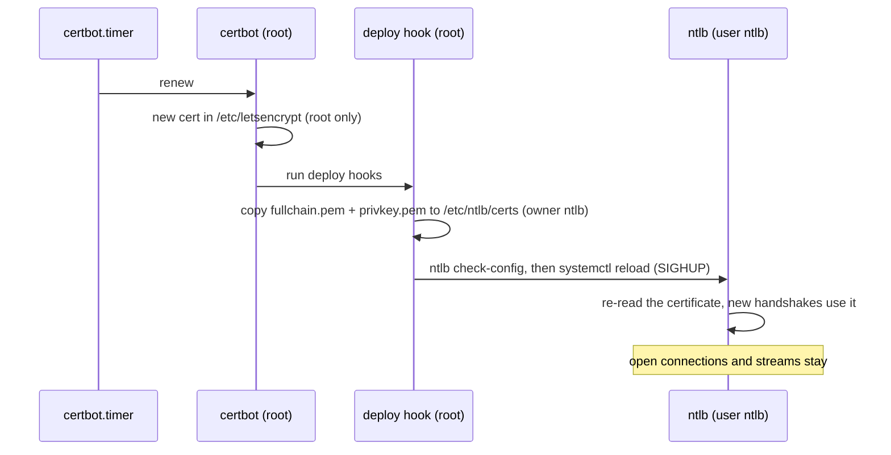
